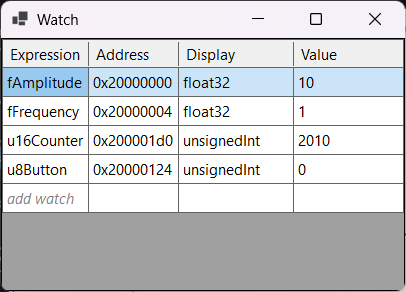
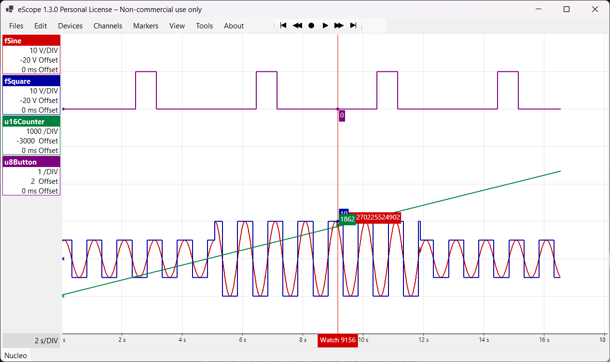
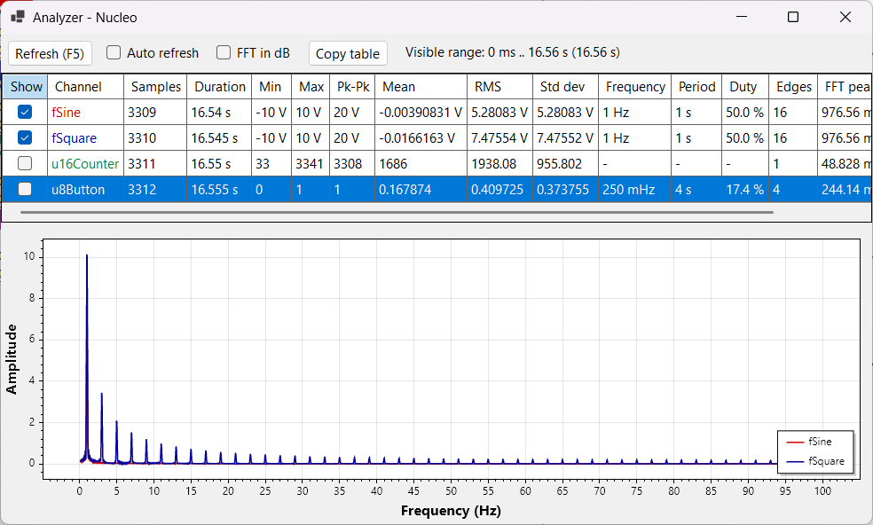

# 1. Getting started with eScope

**English** | [Français](../tutoriels/01-prise-en-main.md)

This tutorial assumes a board is running with the eScope module and a **device** is declared
(tutorials [2](02-arduino-nano-serial.md), [3](03-stm32-nucleo-serial.md) or [4](04-ra4e1-serial.md)).
The screenshots come from the NUCLEO-C051C8 example, whose firmware exposes:

| Variable | Type | Role |
|---|---|---|
| `fSine` | `float` | sine wave `fAmplitude · sin(2π · fFrequency · t)` |
| `fSquare` | `float` | square wave of the same frequency |
| `u16Counter` | `uint16_t` | +1 every sampling period |
| `u8Button` | `uint8_t` | 1 while the blue USER button is pressed |
| `fAmplitude`, `fFrequency` | `float` | parameters that can be changed from eScope |

## The main window

- **Menus**: *Files* (traces, CSV / PNG export), *Edit* (undo / redo, copy / paste of data),
  *Devices*, *Channels*, *Markers*, *View*, *Tools*.
- **Playback bar**: start, back, **record** (●), play / pause, forward, end.
- **Legend** on the left: one box per channel, with its scale (units per division) and its
  offsets. Double-click a box to open its settings.
- **Tabs** at the bottom: one trace per tab (here `Nucleo`).
- **Watch line** (vertical red line): follows the mouse and shows the value of each curve.

## Add a channel

*Channels > New* (**Insert** key) opens the *Channel Edit* window.

1. In **Symbol**, type `<device>.<variable>`, for example `Nucleo.f`: the list offers the symbols
   of the `.elf`. With GDB symbols, any C expression is accepted (`ctx.cfg.gain`, `tab[3].x`,
   `*(uint16_t*)0x20000010`).

   

2. Once the symbol is chosen, **Address** and **Size** fill in by themselves.
3. Set **Display** according to the C type: `Float` for a `float`, `Unsigned Decimal` for a
   `uint*_t`, `Signed Decimal` for an `int*_t`. eScope does not infer it: a `float` left as
   *Signed Decimal* gives absurd values.
4. **Unit** (shown in the legend), **Y Gain** (units per division) and **Y Offset** (vertical
   offset) set the display. They can also be changed later.
5. **OK**.

The **Period (ms)** field is greyed out: the period comes from the device's *Sampling Time*.

## Record

- **Space** (or the ● button) starts recording: eScope opens the link, sends the list of addresses
  to the firmware, and the curves scroll.
- **Space** again stops it. The link is closed: the board can be reprogrammed.

If a frame is missing or the board stops answering, eScope marks it on the curve (small red marks)
instead of joining the points.

## Navigate

| Action | Key |
|---|---|
| Show everything (zoom fit) | **Esc** |
| Zoom in / out | **I** / **O** (or ↑ / ↓) |
| Start / end of the recording | **Ctrl+←** / **Ctrl+→** (or **Home** / **End**) |
| One screen back / forward | **←** / **→** |
| Select an area | **S**, then **Z** to zoom on it |
| Play back the recording | **P** |

Right-clicking the plot opens the context menu: copy the data, analyze, clear the data,
hide / show or delete curves.

## Read and write variables: the Watch window

**W** opens the *Watch* window. It shows the current value of each expression, refreshed at 1 Hz
while recording (one-shot reads, no history).

- Double-click **add watch** to add an expression (same completion as channels).
- Double-click a **Value** cell, type the value, **Enter**: the value is **written to the target's
  RAM** while it runs.

The result on the curves: `fAmplitude` changed from 5 to 10 then back to 5, without stopping the
program or rebuilding.

## Measure

**Delta** (**D** key, or *Markers > New Time Delta*): a time interval between two X positions, here
one period of `fSquare` (1000 ms).

*Markers* also offers horizontal (**H**) and vertical (**V**) lines, and texts (**T**).

**Analyzer** (**A** key, or right-click > *Analyzer*): on the selection, or on the visible part
without a selection, for each channel: min, max, peak-to-peak, mean, RMS, standard deviation,
frequency, period, duty cycle and FFT spectrum. Unchecking **Show** removes a curve from the
spectrum.

## Save

- **Ctrl+S** saves the workspace (`eScope.json` in the current folder): devices, traces, channels,
  settings and data. eScope also offers it when closing.
- *Files > Save Trace As...* saves the current trace alone (`.etrace`).
- *Files > Export Trace (CSV, PNG)...* exports the data or the image.

## After a rebuild

eScope watches the symbol file: when the `.elf` changes, it is reloaded and the channel addresses
are recomputed. Just reprogram the board and start recording again.
