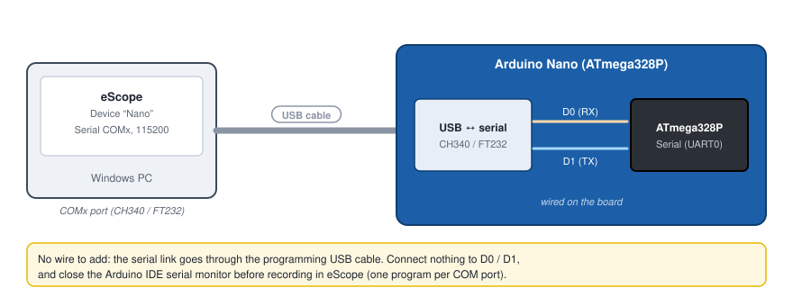
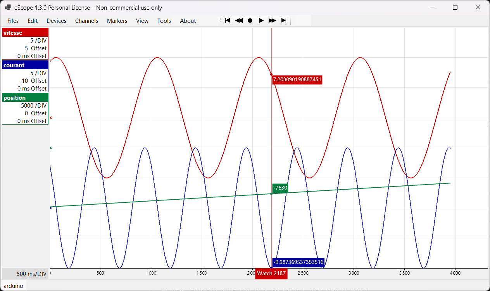

# 2. Arduino Nano over serial 115200

**English** | [Français](../tutoriels/02-arduino-nano-serie.md)

Watch the variables of an Arduino sketch in real time, through the board's USB cable.

| | |
|---|---|
| Board | Arduino Nano (ATmega328P), original or CH340 clone |
| Link | `Serial` (UART0) through the board's USB-serial converter, 115200 baud |
| Protocol | V3, [`DebugScope`](../../targetExamples/arduino/DebugScope.h) library built into the sketch |
| Sampling | 5 ms |
| Software | Arduino IDE 2, eScope |

The same library works on Uno, Mega, ESP32, STM32duino and SAMD (`library.properties`).

## 1. The example sketch

Copy the [`targetExamples/arduino`](../../targetExamples/arduino) folder: it contains the
`arduino.ino` sketch and the library (`DebugScope.h`, `DebugScope.cpp`). The folder must keep the
name `arduino`, like the `.ino` file.

The core of the sketch:

```cpp
#include "DebugScope.h"

volatile float vitesse;      // variables read by eScope: nothing else to declare,
volatile float courant;      // eScope finds their address in the .elf
int32_t position;

DebugScope scope(Serial);    // 115200 baud (DEBUG_SCOPE_BAUDRATE)

void setup()
{
    scope.begin();
}

void loop()
{
    uint32_t now = millis();
    if (now - lastUpdate >= (uint32_t)(DEBUG_SCOPE_TS * 1000))   // every 5 ms
    {
        lastUpdate += (uint32_t)(DEBUG_SCOPE_TS * 1000);
        appUpdate();         // computes vitesse, courant, position
        scope.update();      // receives eScope commands, sends a frame
    }
}
```

The firmware does not know which variables are watched: eScope sends their addresses, `update()`
copies the requested memory. To watch another variable of your program, it only needs to be
**global** (or `static`): no line to add.

`DEBUG_SCOPE_TS` (in `DebugScope.h`) sets the period: 5 ms. At 115200 baud, a 5 ms frame carries up
to ~50 bytes of data. At 1 ms, it only carries 6 bytes.

`Serial` is used by eScope: no `Serial.print` in the sketch. On a Mega, use
`DebugScope scope(Serial1)` to keep `Serial` free.

## 2. Compile, upload, export the `.elf`

1. Open `arduino.ino` in the Arduino IDE.
2. *Tools > Board > Arduino AVR Boards > Arduino Nano*. For many clones:
   *Tools > Processor > ATmega328P (Old Bootloader)*.
3. *Tools > Port*: the board's COM port (on a clone: `USB-SERIAL CH340 (COMx)` in Device Manager;
   install the CH340 driver if no port shows up).
4. **Upload**.
5. *Sketch > Export Compiled Binary*. The IDE creates `build/arduino.avr.nano/arduino.ino.elf` in
   the sketch folder: this is eScope's symbol file. Export again after every change to the sketch.

## 3. Wiring



Nothing to wire: the USB cable powers the board and carries the serial link. **Close the IDE serial
monitor**: a COM port can only be opened by one program at a time.

## 4. Open the ready-made workspace

The sketch folder contains `nano.escope`, a workspace that already declares the `Nano` device
(serial 115200, GDB symbols on `build\arduino.avr.nano\arduino.ino.elf`, V3, 5 ms) and the channels
`vitesse`, `courant` and `position`.

1. Export the `.elf` first (step 2), then open `nano.escope`: *Files > Open...* (**Ctrl+O**), or drop
   the file on the eScope window.
2. *Devices > Nano*: choose the board's **Port**, then **OK**. The list shows the device behind each
   port, for example `COM5 (USB-SERIAL CH340)`.
3. **Ctrl+S** to keep the port in `nano.escope`. eScope reopens it at the next start.

Go to [step 6](#6-record). Section 5 describes the same setup made by hand, for your own sketches.

## 5. Or declare the device and channels yourself

*Devices > New*:

| Field | Value |
|---|---|
| Name | `Nano` |
| Communication | **Serial** |
| Port | the board's COM port |
| Baudrate | `115200` |
| Symbols | **GDB** |
| Symbol File | `...\build\arduino.avr.nano\arduino.ino.elf` |
| GDB path | filled in automatically (bundled GDB) |
| Protocol | **V3** |
| Sampling Time | `5` (the `DEBUG_SCOPE_TS` period, in ms) |


On AVR, GDB gives RAM addresses with the `0x800000` prefix of the data space
(`&vitesse` = `0x80011a`): this is normal, the firmware only keeps the 16 useful bits.

Then *Channels > New* (**Insert** key) for each variable:

| Symbol | Display | Y Gain |
|---|---|---|
| `Nano.vitesse` | Float | 5 |
| `Nano.courant` | Float | 5 |
| `Nano.position` | Signed Decimal | 5000 |

## 6. Record

**Space** to record:



The rest (navigation, Watch, measurements) is described in [Getting started](01-getting-started.md).

## Troubleshooting

| Symptom | Likely cause |
|---|---|
| The COM port does not open | IDE serial monitor open, or wrong port |
| No `Nano` device in the *Devices* menu | `nano.escope` not opened: the title bar shows the workspace in use |
| No COM port for the board, power LED on | charge-only USB cable (no data wires): try another cable |
| Channels without address | `.elf` exported after eScope was started: restart eScope |
| No curve, no error | sketch not uploaded, or `Sampling Time` / baudrate different from the firmware |
| Absurd values on a `float` | *Display* left as *Signed Decimal*: choose *Float* |
| Curves shifted after changing the sketch | `.elf` not exported again: redo *Export Compiled Binary* |
| Error when adding many channels | frame too long for the period (`DEBUG_SCOPE_TX_MAX`): fewer channels, or a longer period |
