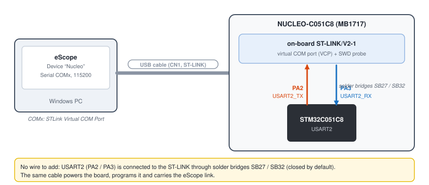
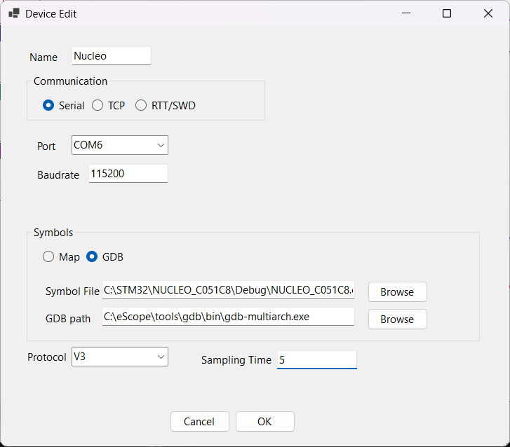
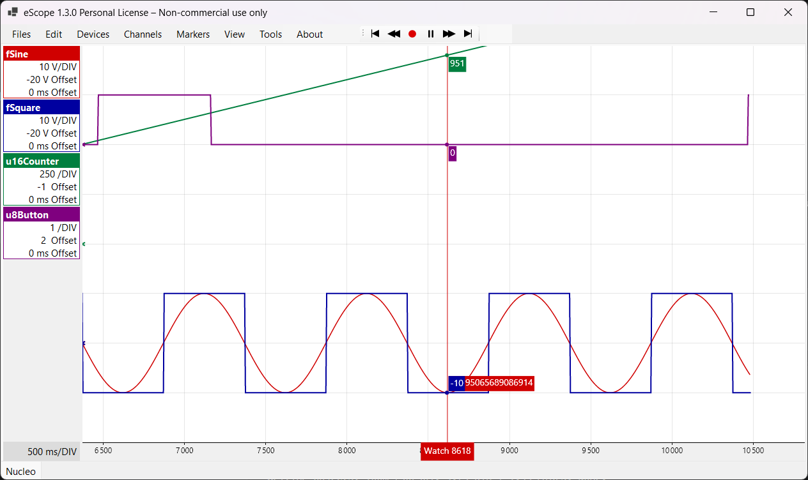

# 3. STM32 NUCLEO-C051C8 over serial 115200

**English** | [Français](../tutoriels/03-stm32-nucleo-serie.md)

Watch and change the variables of an STM32 in real time, through the virtual COM port of the
board's on-board ST-LINK: a single USB cable, no wire.

| | |
|---|---|
| Board | NUCLEO-C051C8 (MB1717, STM32C051C8, Cortex-M0+) |
| Link | USART2 (PA2 / PA3) → ST-LINK → virtual COM port, 115200 baud |
| Protocol | V3 ([`eScopeProtocol`](../../targetExamples/eScopeProtocol)) |
| Sampling | 5 ms |
| Software | STM32CubeIDE, eScope |

## 1. Import the example project

1. In STM32CubeIDE: *File > Import > General > Existing Projects into Workspace*.
2. *Select root directory*: `targetExamples/stm32/NUCLEO_C051C8` in the eScope repository.
3. **Uncheck** *Copy projects into workspace*: the project references the repository's
   `eScopeProtocol`, `eScopeTransport` and `SEGGER_RTT` folders through a relative path (two levels
   above the project). Copied elsewhere, it no longer finds them.

## 2. Configure eScope in the firmware

The whole configuration is in [`Core/Inc/eScopeCfg.h`](../../targetExamples/stm32/NUCLEO_C051C8/Core/Inc/eScopeCfg.h):

```c
#define ESCOPE_PROTOCOL_V3              /* full protocol: read, write           */
#define ESCOPE_TRANSPORT_UART           /* serial link                          */
#define ESCOPE_PROTOCOL_BAUDRATE 115200

#define ESCOPE_UART_ID  ESCOPE_UART_VCP /* USART2 PA2/PA3 = ST-LINK COM port    */
#define ESCOPE_SAMPLING_MS  (5U)        /* = "Sampling Time" of the eScope device */
```

The integration in [`Core/Src/main.c`](../../targetExamples/stm32/NUCLEO_C051C8/Core/Src/main.c)
takes a few lines, all in `USER CODE` sections (kept when CubeMX regenerates the code):

```c
#include "eScopeProtocol.h"

static uint8_t             tu8eScopeCfg[ESCOPE_PROTOCOL_EEPROM_SIZE];
static eScopeProtocolCfg_t sProtoCfg = { .pu8Cfg = tu8eScopeCfg };
static eScopeProtocol_t    sProto;

/* in main(), after BSP_COM_Init(COM1, ...) which sets USART2 to 115200 8N1 */
eScopeTransportCfg_t sTransCfg = { .u8Id = ESCOPE_UART_ID };
eScopeProtocol_Init(&sProto, &sTransCfg, &sProtoCfg);

uint32_t u32LastTick = HAL_GetTick();
while (1)
{
    eScopeProtocol_Poll(&sProto);
    if ((HAL_GetTick() - u32LastTick) >= ESCOPE_SAMPLING_MS)
    {
        u32LastTick += ESCOPE_SAMPLING_MS;
        App_Update();                     /* the application: computes fSine, fSquare… */
        eScopeProtocol_Process(&sProto);  /* sends a frame                             */
    }
}

/* reception: one byte per interrupt */
void HAL_UART_RxCpltCallback(UART_HandleTypeDef* huart)
{
    eScopeTransportUartStm32_RxCallback(&sProto.sTransport, huart);
}
```

The `USART2_IRQHandler` / `USART1_IRQHandler` handlers are in `stm32c0xx_it.c`, the HAL transport in
`Core/Src/eScopeTransportUart.c`. The call period of `eScopeProtocol_Process()` is the sampling
period: it must be regular.

## 3. Compile, program

1. *Project > Build Project*: produces `Debug/NUCLEO_C051C8.elf`, eScope's symbol file.
2. Plug in the board, *Run > Run*: the ST-LINK programs the STM32 and the program starts.

## 4. Wiring



Nothing to wire. In Device Manager, the board shows up as
**STMicroelectronics STLink Virtual COM Port (COMx)** (driver installed with STM32CubeIDE).

## 5. Declare the device in eScope

*Devices > New*:

| Field | Value |
|---|---|
| Name | `Nucleo` |
| Communication | **Serial**, ST-LINK `COMx` port, baudrate `115200` |
| Symbols | **GDB**, Symbol File `...\NUCLEO_C051C8\Debug\NUCLEO_C051C8.elf` |
| Protocol | **V3** |
| Sampling Time | `5` (`ESCOPE_SAMPLING_MS`) |



## 6. Channels, recording, writing

*Channels > New* (**Insert** key):

| Symbol | Display | Unit | Y Gain |
|---|---|---|---|
| `Nucleo.fSine` | Float | V | 10 |
| `Nucleo.fSquare` | Float | V | 10 |
| `Nucleo.u16Counter` | Unsigned Decimal | | 1000 |
| `Nucleo.u8Button` | Unsigned Decimal | | 1 |

**Space** starts recording. Press the blue **USER** button: `u8Button` goes to 1.



**W** opens the Watch: add `fAmplitude` and `fFrequency`, then double-click their value to change
it. The firmware reads these variables every period: the sine wave changes immediately.


All eScope features are detailed in [Getting started](01-getting-started.md).

## Add eScope to your own STM32 project

1. Add the `targetExamples/eScopeProtocol` and `targetExamples/eScopeTransport` folders to the
   project (linked or copied folders) and put them in the include paths.
2. Copy `eScopeCfg.h`, `eScopeDep.h` (PRIMASK critical section, valid on any Cortex-M) and
   `eScopeTransportUart.c` into your project. In the latter, adapt the `u8Id` →
   `UART_HandleTypeDef` mapping.
3. Enable the interrupt of the chosen UART and call `HAL_UART_IRQHandler()` from its handler.
4. Call `eScopeProtocol_Init()` after the UART initialization, then `eScopeProtocol_Poll()` and
   `eScopeProtocol_Process()` at a fixed period as above.
5. Route `HAL_UART_RxCpltCallback()` to `eScopeTransportUartStm32_RxCallback()`.

## Troubleshooting

| Symptom | Likely cause |
|---|---|
| No ST-LINK COM port | ST-LINK driver missing (installed with STM32CubeIDE), or charge-only USB cable |
| The build cannot find `eScopeProtocol.h` | project copied into the workspace: import again without *Copy projects into workspace* |
| No data | baudrate different from the firmware, or program halted by the debugger (breakpoint on `main`) |
| Wrong time axis | `Sampling Time` different from `ESCOPE_SAMPLING_MS` |
| Unexpected sawtooth curves | `float` displayed as *Signed Decimal*: choose *Float* |
