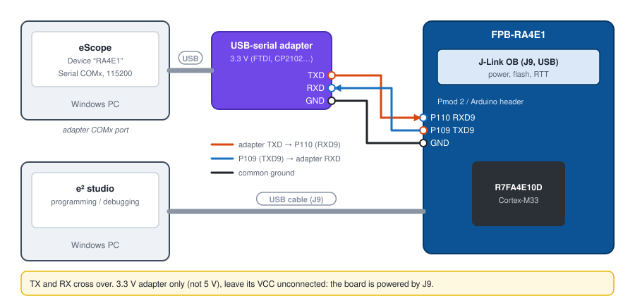

# 4. Renesas FPB-RA4E1 over serial 115200

**English** | [Français](../tutoriels/04-ra4e1-serie.md)

Watch the variables of a Renesas RA4E1 over a 115200 baud serial link on SCI9, with a USB-serial
adapter. The same project also works over RTT through the on-board J-Link probe, without an adapter
(section 7).

| | |
|---|---|
| Board | FPB-RA4E1 (R7FA4E10D, Cortex-M33), on-board J-Link OB |
| Link | SCI9: P109 = TXD9, P110 = RXD9, 115200 baud, **3.3 V** USB-serial adapter |
| Protocol | V3Id ([`eScopeProtocolV3Id`](../../targetExamples/eScopeProtocol/eScopeProtocolV3Id.h)): V3 with the configuration in a structure; on the eScope side, protocol **V3** |
| Sampling | 5 ms over serial, 1 ms over RTT |
| Software | e² studio with FSP, eScope |

## 1. Import the example project

1. In e² studio: *File > Import > General > Existing Projects into Workspace*.
2. *Select root directory*: `targetExamples/ra/FPB_RA4E1` in the eScope repository.
3. **Uncheck** *Copy projects into workspace*: the project references the repository's
   `eScopeProtocol`, `eScopeTransport` and `SEGGER_RTT` through a relative path.

The firmware ([`src/hal_entry.c`](../../targetExamples/ra/FPB_RA4E1/src/hal_entry.c)) blinks the LED
and exposes two variables:

```c
volatile uint32_t u32Counter;   /* +1 per period                    */
volatile float    fSineApprox;  /* 10 · sin(2π · 1 Hz · t)          */
```

## 2. Add the SCI9 UART in the FSP

Open `configuration.xml` (*FSP Configuration*):

1. **Stacks** tab: *New Stack > Connectivity > UART (r_sci_uart)*. In the properties:

   | Property | Value |
   |---|---|
   | Name | `g_uart9` |
   | Channel | `9` |
   | Baud Rate | `115200` |
   | Data Bits / Parity / Stop Bits | 8 / None / 1 |
   | Callback | `eScope_uart_callback` |

2. **Pins** tab: *Peripherals > Connectivity:SCI > SCI9*, *Asynchronous UART* mode,
   TXD9 = **P109**, RXD9 = **P110**.
3. **Generate Project Content**.

The names `g_uart9` and `eScope_uart_callback` are the ones expected by the
[`src/eScopeTransportUart.c`](../../targetExamples/ra/FPB_RA4E1/src/eScopeTransportUart.c) transport.

## 3. Select the UART transport

In [`src/eScopeCfg.h`](../../targetExamples/ra/FPB_RA4E1/src/eScopeCfg.h), comment out RTT and
enable UART:

```c
/* #define ESCOPE_TRANSPORT_RTT */
   #define ESCOPE_TRANSPORT_UART    /* SCI9 P109/P110, FSP stack g_uart9 */
```

`ESCOPE_SAMPLING_MS` then becomes 5 ms: `hal_entry.c` calls `eScopeProtocol_Process()` at this
period (`R_BSP_SoftwareDelay`).

## 4. Compile, program

1. *Project > Build Project*: produces `Debug/FPB_RA4E1.elf`.
2. Plug in the board through **J9** (J-Link OB), then *Run > Debug* (or *Run*): e² studio programs
   the RA4E1. In a debug session, resume execution (**F8**): when halted, the program sends nothing.

## 5. Wiring



| USB-serial adapter | FPB-RA4E1 |
|---|---|
| TXD | **P110** (RXD9) |
| RXD | **P109** (TXD9) |
| GND | GND |
| VCC | do not connect |

P109 / P110 are on the Pmod 2 connector and on the board's Arduino header (see the
*FPB-RA4E1 User's Manual*). The adapter must be **3.3 V**.

## 6. Declare the device in eScope

| Field | Value |
|---|---|
| Name | `RA4E1` |
| Communication | **Serial**, adapter COM port, baudrate `115200` |
| Symbols | **GDB**, Symbol File `...\FPB_RA4E1\Debug\FPB_RA4E1.elf` |
| Protocol | **V3** |
| Sampling Time | `5` |


Channels: `RA4E1.fSineApprox` (Float, Y Gain 5) and `RA4E1.u32Counter` (Unsigned Decimal,
Y Gain 1000). **Space** to record:


## 7. RTT variant (the project's original configuration)

Without an adapter or wire, eScope reads the RAM through the J-Link OB probe (same principle as in
[tutorial 5](05-stm32-rtt.md)):

1. `eScopeCfg.h`: `ESCOPE_TRANSPORT_RTT` (shipped setting), `ESCOPE_SAMPLING_MS` = 1.
2. On the PC: Python 3, `pip install pyocd` then `pyocd pack install r7fa4e10d`. With the SEGGER
   J-Link software installed, `pip install pylink-square` makes the bridge use the J-Link's native
   RTT (automatic).
3. eScope device: **RTT/SWD**, Target `r7fa4e10d`, Probe = the J-Link OB (*Refresh* for the list),
   Sampling Time `1`.


Close the e² studio debug session before recording: the probe serves only one program at a time.

## Troubleshooting

| Symptom | Likely cause |
|---|---|
| Compile errors, `g_uart9` unknown | r_sci_uart stack missing or named differently, or FSP content not regenerated |
| No data over serial | TX / RX not crossed, ground not connected, or program halted in the debugger |
| Lost characters | 5 V adapter, or `Sampling Time` too short for the number of channels |
| RTT: "no probe" | e² studio debug session still open, or pyOCD pack not installed |
