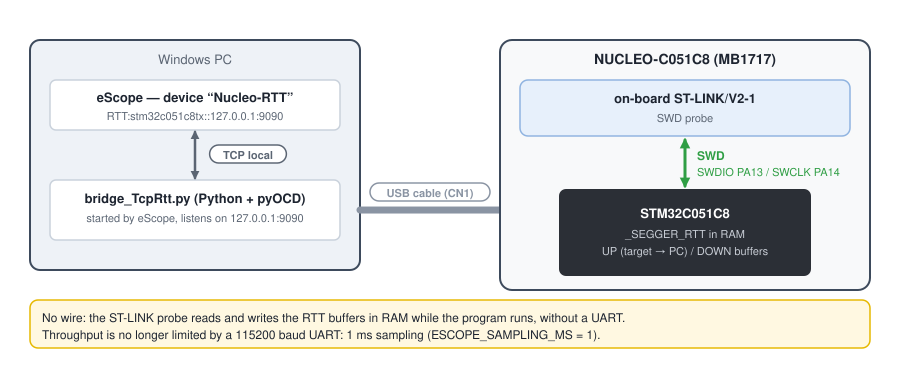
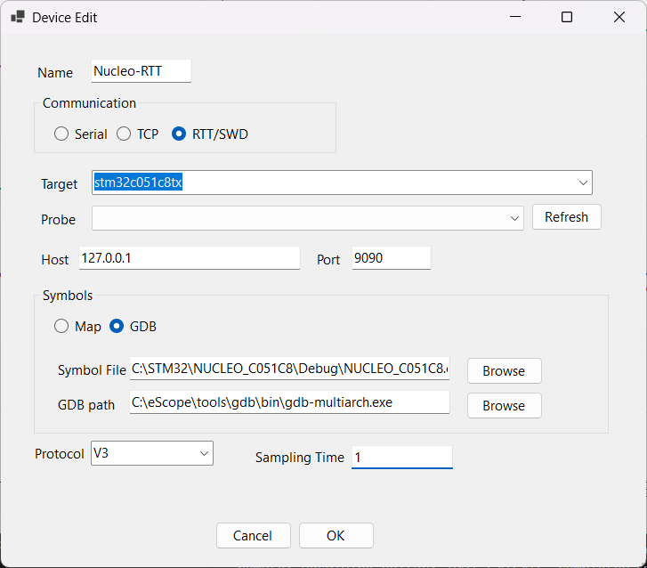

# 5. STM32 NUCLEO-C051C8 over RTT

**English** | [Français](../tutoriels/05-stm32-rtt.md)

Replace the serial link with **SEGGER RTT**: eScope reads and writes buffers in the STM32's RAM
through the ST-LINK SWD probe, while the program runs. No UART, no wire, and a throughput no longer
limited to 115200 baud: 1 ms sampling.

Prerequisite: [tutorial 3](03-stm32-nucleo-serial.md) (project imported, built, programmed).

## Principle



- The firmware declares the `_SEGGER_RTT` control block and two ring buffers in RAM (SEGGER sources
  in [`targetExamples/SEGGER_RTT`](../../targetExamples/SEGGER_RTT)).
- eScope starts `bridge_TcpRtt.py` (shipped next to `eScope.exe`): this Python script drives the
  probe with **pyOCD**, and exchanges data with eScope over TCP on `127.0.0.1:9090`.
- eScope looks up the address of `_SEGGER_RTT` in the `.elf` and gives it to the bridge: no search
  in RAM.

## 1. Install pyOCD (once)

```powershell
python --version                     # Python 3 in the PATH
pip install pyocd
pyocd pack install stm32c051c8tx     # target description (downloads the ST pack)
python -m pyocd list --probes        # the connected board must show up
```

## 2. Switch the firmware to RTT

In [`Core/Inc/eScopeCfg.h`](../../targetExamples/stm32/NUCLEO_C051C8/Core/Inc/eScopeCfg.h):

```c
/* #define ESCOPE_TRANSPORT_UART */
   #define ESCOPE_TRANSPORT_RTT     /* SEGGER RTT through the ST-LINK (SWD) */
```

`ESCOPE_SAMPLING_MS` automatically becomes 1 ms. The rest of the code does not change: the same
`{ .u8Id = 0 }` structure designates RTT channel 0, and `eScopeProtocol_Poll()` reads the down
buffer (PC → target) on every loop iteration.

The project already compiles `SEGGER_RTT.c` (linked `SEGGER_RTT` folder, in the include paths).
Rebuild, program (*Run > Run*), and **end any debug session**: the probe serves only one program at
a time.

## 3. Wiring

None: the ST-LINK USB cable carries the SWD (PA13 / PA14, connected on the board).

## 4. Declare the device in eScope

*Devices > New*:

| Field | Value |
|---|---|
| Name | `Nucleo-RTT` |
| Communication | **RTT/SWD** |
| Target | `stm32c051c8tx` (list of pyOCD targets, typed with completion) |
| Probe | the ST-LINK (*Refresh* to read the list again); empty = single probe chosen automatically |
| Host / Port | `127.0.0.1` / `9090` |
| Symbols | **GDB**, `...\Debug\NUCLEO_C051C8.elf` |
| Protocol | **V3** |
| Sampling Time | `1` |



When recording (**Space**), eScope starts the bridge, waits until it is ready, then connects to it.
When stopping, it closes it. Channels are created as over serial
([tutorial 3](03-stm32-nucleo-serial.md#6-channels-recording-writing)); the Watch and variable
writing work the same way.

## Going further

- **J-Link probe**: with the SEGGER software installed and `pip install pylink-square`, the bridge
  uses the J-Link's native RTT (chosen automatically).
- **Bridge on another machine**: put that machine's address in *Host*; eScope connects to it
  instead of starting the bridge. Start it by hand:
  `python bridge_TcpRtt.py --target stm32c051c8tx --host 0.0.0.0 --port 9090`.
- **Another board**: any Cortex-M target known to pyOCD (`python -m pyocd list --targets`), with
  `ESCOPE_TRANSPORT_RTT` in its `eScopeCfg.h` and `eScopeProtocol_Poll()` before
  `eScopeProtocol_Process()`.

## Troubleshooting

| Symptom | Likely cause |
|---|---|
| Empty *Target* list | Python or pyOCD missing from the `PATH` |
| Empty *Probe* list | board unplugged, or STM32CubeIDE debug session open |
| The bridge starts but no data | firmware still on `ESCOPE_TRANSPORT_UART`, or stale `_SEGGER_RTT` address: it is read from the `.elf` when clicking **OK** in the device; after a rebuild that moves it, open the device again and confirm |
| Port 9090 in use | another bridge is running: close it, or change *Port* |
