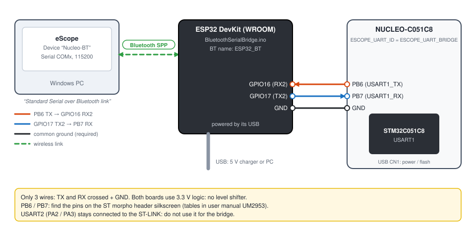

# 6. STM32 NUCLEO-C051C8 over Bluetooth

**English** | [Français](../tutoriels/06-stm32-bluetooth.md)

Watch the board **without a cable to the PC**: an ESP32 relays the STM32's 115200 baud serial link
over Bluetooth. On the PC side, Bluetooth shows up as a COM port: eScope sees it as an ordinary
serial link.

Prerequisite: [tutorial 3](03-stm32-nucleo-serial.md) (project imported, built, programmed).

| | |
|---|---|
| Hardware | NUCLEO-C051C8, ESP32 DevKit (WROOM module, "classic" ESP32), 3 wires |
| STM32 ↔ ESP32 link | USART1: PB6 (TX), PB7 (RX), 115200 baud 8N1, 3.3 V |
| ESP32 ↔ PC link | Bluetooth Classic, serial profile (SPP), name `ESP32_BT` |
| Bridge | [`BluetoothSerialBridge.ino`](../../BluetoothSerialBridge/BluetoothSerialBridge.ino) |

Bluetooth Classic only exists on the original ESP32: an ESP32-S3, -C3 or -C6 (Bluetooth Low Energy
only) does not work.

## 1. STM32 firmware: use USART1

USART2 (PA2 / PA3) is connected to the ST-LINK: an external bridge on these pins would conflict with
it. The example therefore provides a second UART, USART1 on PB6 / PB7. In
[`Core/Inc/eScopeCfg.h`](../../targetExamples/stm32/NUCLEO_C051C8/Core/Inc/eScopeCfg.h):

```c
#define ESCOPE_TRANSPORT_UART
#define ESCOPE_UART_ID  ESCOPE_UART_BRIDGE   /* USART1 PB6 (TX) / PB7 (RX) */
```

`main.c` then initializes USART1 (`MX_USART1_UART_Init()`, pins configured in `HAL_UART_MspInit()`
of `stm32c0xx_hal_msp.c`). Rebuild and program the board.

## 2. Program the ESP32

1. In the Arduino IDE, install the ESP32 platform: *File > Preferences > Additional boards manager
   URLs*: `https://espressif.github.io/arduino-esp32/package_esp32_index.json`, then
   *Tools > Board > Boards Manager*: **esp32** (Espressif Systems).
2. Open `BluetoothSerialBridge/BluetoothSerialBridge.ino`.
3. *Tools > Board > esp32 > ESP32 Dev Module*, choose the ESP32's port, **Upload**.

The sketch relays UART2 (GPIO16 = RX2, GPIO17 = TX2, 115200 baud) and Bluetooth
(`SerialBT.begin("ESP32_BT")`) in both directions. It also copies the traffic to the ESP32's USB
port, for debugging. The blue LED (GPIO2) lights up when data arrives over USB.

## 3. Wiring



| NUCLEO-C051C8 | ESP32 DevKit |
|---|---|
| PB6 (USART1_TX) | GPIO16 (RX2) |
| PB7 (USART1_RX) | GPIO17 (TX2) |
| GND | GND |

- TX goes to RX and vice versa.
- The common ground is required.
- Both boards are 3.3 V: no level shifter.
- PB6 and PB7 are on the ST morpho connectors: find the pins on the silkscreen or in the connector
  tables of the board's user manual (UM2953).

Power: the Nucleo through its USB (or an external supply), the ESP32 through its USB (5 V charger,
battery or PC).

## 4. Pair the ESP32 with Windows

1. *Settings > Bluetooth & devices > Add device > Bluetooth*: choose **ESP32_BT**.
2. *Bluetooth & devices > Devices > More Bluetooth settings*, **COM Ports** tab: note the
   **Outgoing** port associated with `ESP32_BT`. This is the one eScope uses.

Windows often creates two ports per device (incoming and outgoing): only the outgoing one lets
eScope open the connection.

## 5. Declare the device in eScope

| Field | Value |
|---|---|
| Name | `Nucleo-BT` |
| Communication | **Serial**, **outgoing** COM port of `ESP32_BT`, baudrate `115200` |
| Symbols | **GDB**, `...\Debug\NUCLEO_C051C8.elf` |
| Protocol | **V3** |
| Sampling Time | `5` |


**Space**: when the port opens, Windows establishes the Bluetooth connection (one to two seconds),
then the curves arrive as over USB serial ([tutorial 3](03-stm32-nucleo-serial.md#6-channels-recording-writing)).
The throughput remains that of the 115200 baud UART. Bluetooth adds a little latency, with no effect
on the time axis: eScope places each frame at its position (one frame per *Sampling Time*), not at
its arrival time.

## Troubleshooting

| Symptom | Likely cause |
|---|---|
| `ESP32_BT` not found | ESP32 not powered, sketch not uploaded, or ESP32 without Bluetooth Classic |
| The COM port does not open | **incoming** port chosen instead of the outgoing one, or ESP32 out of range |
| Connected, no data | TX / RX not crossed, GND not connected, or STM32 firmware still on `ESCOPE_UART_VCP` |
| Choppy data | Bluetooth range at its limit, or `Sampling Time` too short for the number of channels |
