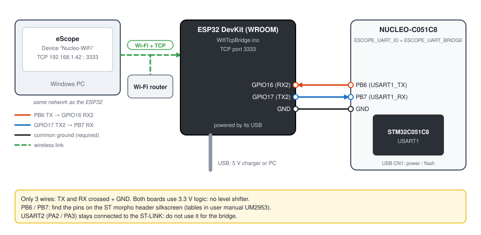

# 7. STM32 NUCLEO-C051C8 over Wi-Fi / TCP

**English** | [Français](../tutoriels/07-stm32-wifi-tcp.md)

Watch the board across the network: an ESP32 relays the STM32's 115200 baud serial link over a TCP
connection on Wi-Fi. eScope connects to it with the **TCP** link.

Prerequisite: [tutorial 3](03-stm32-nucleo-serial.md) (project imported, built, programmed). The
wiring is the same as in [tutorial 6](06-stm32-bluetooth.md): only the ESP32 sketch changes.

| | |
|---|---|
| Hardware | NUCLEO-C051C8, ESP32 DevKit (any ESP32 with Wi-Fi), 3 wires, 2.4 GHz Wi-Fi network |
| STM32 ↔ ESP32 link | USART1: PB6 (TX), PB7 (RX), 115200 baud 8N1, 3.3 V |
| ESP32 ↔ PC link | TCP, port 3333, one client at a time |
| Bridge | [`WifiTcpBridge.ino`](../../WifiTcpBridge/WifiTcpBridge.ino) |

The NUCLEO-C051C8 has no network interface: the ESP32 acts as a serial ↔ TCP gateway. A board with
built-in Ethernet or Wi-Fi could implement the TCP transport directly (`ESCOPE_TRANSPORT_TCP`,
skeleton in [`eScopeTransportTcp.c`](../../targetExamples/eScopeTransport/eScopeTransportTcp.c)).

## 1. STM32 firmware: use USART1

As for Bluetooth, in `Core/Inc/eScopeCfg.h`:

```c
#define ESCOPE_TRANSPORT_UART
#define ESCOPE_UART_ID  ESCOPE_UART_BRIDGE   /* USART1 PB6 (TX) / PB7 (RX) */
```

Rebuild and program the board.

## 2. Program the ESP32

1. Install the **esp32** platform in the Arduino IDE (see
   [tutorial 6](06-stm32-bluetooth.md#2-program-the-esp32)).
2. Open `WifiTcpBridge/WifiTcpBridge.ino` and fill in the network:

   ```cpp
   const char* WIFI_SSID     = "your-ssid";
   const char* WIFI_PASSWORD = "your-password";
   const uint16_t TCP_PORT   = 3333;
   ```

3. *Tools > Board > esp32 > ESP32 Dev Module*, **Upload**.
4. Open the serial monitor (115200 baud) and press **EN** (reset) on the ESP32: it shows its
   address, for example `eScope TCP bridge ready: 192.168.1.42:3333`. Close the monitor.

To keep the address from changing, reserve a fixed address for the ESP32 in the router (static
DHCP lease).

The sketch relays UART2 (GPIO16 / GPIO17) and the TCP client in both directions. The LED (GPIO2)
stays on while eScope is connected. A new client replaces the previous one.

## 3. Wiring



| NUCLEO-C051C8 | ESP32 DevKit |
|---|---|
| PB6 (USART1_TX) | GPIO16 (RX2) |
| PB7 (USART1_RX) | GPIO17 (TX2) |
| GND | GND |

TX and RX crossed, common ground, everything at 3.3 V. The ESP32 can be powered by a simple USB
charger: it no longer needs the PC.

## 4. Declare the device in eScope

| Field | Value |
|---|---|
| Name | `Nucleo-WiFi` |
| Communication | **TCP**, Address = the address shown by the ESP32, Port `3333` |
| Symbols | **GDB**, `...\Debug\NUCLEO_C051C8.elf` |
| Protocol | **V3** |
| Sampling Time | `5` |


**Space**: eScope opens the TCP connection, the ESP32's LED lights up and the curves arrive as over
serial ([tutorial 3](03-stm32-nucleo-serial.md#6-channels-recording-writing)). The PC and the ESP32
must be on the same network (or routed to each other); the connection starts from the PC, so no
inbound rule needs to be opened in the Windows firewall.

## Troubleshooting

| Symptom | Likely cause |
|---|---|
| The ESP32 prints dots forever | wrong SSID / password, or 5 GHz-only network |
| eScope does not connect | IP address changed (reserve a fixed address), PC on another network or isolated guest network |
| Connected (LED on), no data | TX / RX not crossed, GND not connected, or STM32 firmware still on `ESCOPE_UART_VCP` |
| Dropouts | weak Wi-Fi: move the ESP32 closer to the access point |
