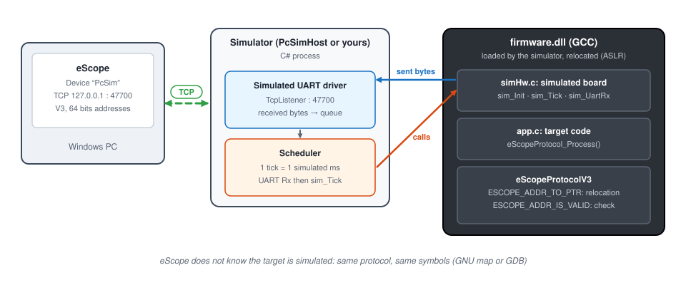
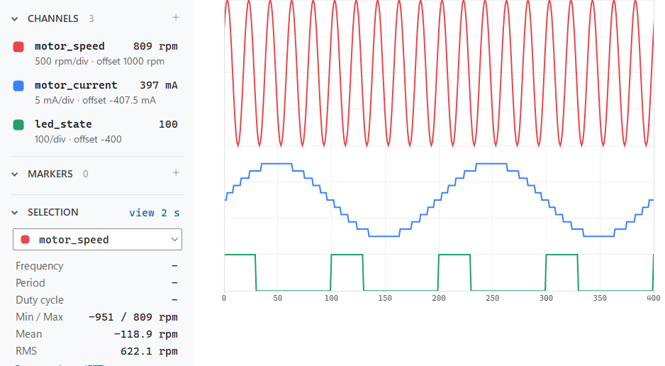

# 8. Firmware simulation on PC

**English** | [Français](../tutoriels/08-simulation-pc.md)

Watch a firmware running **on the PC**, without a board: the target code is built as a DLL with GCC and
run by a simulator that simulates the board (timer, UART…). eScope connects to it over **TCP** as to a
real target: same V3 protocol, same symbols, same traces.

Prerequisite: [tutorial 1](01-getting-started.md) for using eScope.

| | |
|---|---|
| Hardware | none: a Windows PC |
| Tools | [MSYS2](https://www.msys2.org/) with the `mingw-w64-ucrt-x86_64-gcc` and `make` packages, .NET 8 SDK |
| Simulator ↔ PC link | TCP `127.0.0.1:47700`, one client at a time |
| Example | [`targetExamples/pcsim`](../../targetExamples/pcsim): firmware, `PcSimHost` simulator, `Makefile`, `eScope.json` |



The firmware keeps its **UART** transport: the **UART driver of the simulator** relays the bytes to a TCP
socket. Neither the firmware nor eScope sees a difference with a serial link.

## 1. Install the toolchain

1. Install MSYS2, for example to `C:\msys64`.
2. Open the **MSYS2 UCRT64** shell and install GCC and make:

   ```sh
   pacman -S mingw-w64-ucrt-x86_64-gcc make
   ```

3. Install the **.NET 8 SDK** (to build the `PcSimHost` simulator).

## 2. Build the firmware and the simulator

In the MSYS2 UCRT64 shell, from the example folder:

```sh
cd /c/path/to/eScope/targetExamples/pcsim
make
```

| Output | Role |
|---|---|
| `build/firmware.dll` | the firmware: `app.c` (the target code), `simHw.c` (the simulated board), eScopeProtocolV3 |
| `build/firmware.map` | the symbols for eScope (GNU map, with the variable sizes) |
| `build/PcSimHost.exe` | the simulator: loads the DLL, runs it in simulated time, relays its UART to TCP |

`make firmware` rebuilds the DLL only, `make clean` deletes `build/`. If `dotnet` is not found from
MSYS2, give its path: `make DOTNET=/c/Program\ Files/dotnet/dotnet.exe`.

## 3. Start the simulator

```sh
./build/PcSimHost.exe
```

```
firmware ...\build\firmware.dll loaded at 0x7FFA47A30000, eScope UART on TCP 127.0.0.1:47700, speed x1
Ctrl+C to stop
```

The load address changes at each start (Windows ASLR): this is expected, the firmware translates the
addresses itself (see [64 bits addresses and relocation](#7-64-bits-addresses-and-relocation)).

Options: `--port 47700`, `--speed 5` (simulation 5 times faster than real time), and the path of another
DLL.

## 4. Declare the device in eScope

The simplest: start eScope **from the `targetExamples/pcsim` folder**, it loads `eScope.json` and the
`PcSim` device is ready. To declare it by hand:

| Field | Value |
|---|---|
| Name | `PcSim` |
| Communication | **TCP**, Address `127.0.0.1`, Port `47700` |
| Symbols | **Map**, `...\targetExamples\pcsim\build\firmware.map` (or **GDB** on `firmware.dll`) |
| Protocol | **V3** |
| Addresses | **64 bits** |
| Sampling Time | `1` |

**Addresses: 64 bits** is required: the DLL is an x64 binary whose variables are above 4 GB
(`0x180003130`…). With 32 bits, the firmware answers an error and eScope writes in the log "the device
expects 64 bits addresses".

With **GDB**, eScope reads the debug information (DWARF, `-g` option of the `Makefile`): types, sizes,
structure members and C expressions, as with an `.elf`.

## 5. Channels, recording, writing

Add the `motor_speed`, `motor_current` and `led_state` channels, then record (**Ctrl+Space**):



| Variable | Content |
|---|---|
| `motor_speed` | `1000 * sin(2π·50 Hz·t)`, int16 |
| `motor_current` | `motor_cfg * 10 + 5 * sin(2π·5 Hz·t)`, int16 |
| `motor_cfg` | uint32, 7 at start, to write from the Watch |
| `led_state` | 10 Hz square, 30 % duty cycle (0 / 100) |

Write `motor_cfg` from the Watch (for example 40): `motor_current` moves to around 400.

## 6. Simulated time

There is no timestamp, as on a target: eScope's time axis is the **sampling cadence**, one frame per call
of `eScopeProtocol_Process()`. Here `app.c` calls it on every 1 ms simulated tick, hence
**Sampling Time = 1**.

- `--speed 5`: one second of recording holds five seconds of simulation. The 50 Hz signal stays at 50 Hz
  on eScope's axis.
- Simulation paused (breakpoint in the simulator): no more frames, eScope reports a communication loss
  (timeout), then resumes by itself.

## 7. 64 bits addresses and relocation

eScope sends **link** addresses, read from the map or by GDB. Windows loads the DLL elsewhere (ASLR). The
translation is done on the firmware side, in `firmware/eScopeCfg.h`, without eScope having to know:

```c
#define ESCOPE_PROTOCOL_ADDRESS_SIZE  (8U)      /* eScope: "Addresses: 64 bits" */

extern char __ImageBase;                       /* actual load address of the DLL */
#define ESCOPE_ADDR_TO_PTR(addr) \
    ((uint8_t*)((uintptr_t)&__ImageBase + (uintptr_t)((addr) - SIM_LINK_BASE)))

bool simHw_IsValid(const uint8_t* pu8, uint32_t u32Size);
#define ESCOPE_ADDR_IS_VALID(ptr, size)  simHw_IsValid((ptr), (size))
```

- `SIM_LINK_BASE` is the link base of the DLL, defined once in the `Makefile` (`LINK_BASE = 0x180000000`)
  and given both to the linker (`--image-base`) and to the code (`-D`).
- `ESCOPE_ADDR_IS_VALID` refuses an access outside the DLL image: a wrong address gives an error
  (`ERR_ADDR`, failed read in eScope) instead of crashing the simulator.

## 8. Connect eScope to your own simulator

`PcSimHost` is a minimal simulator. In an existing simulator that already loads the firmware as a DLL and
simulates the board, three things are needed:

1. **Firmware side**: eScopeProtocolV3 on the UART transport of the board, and the configuration above
   (`ESCOPE_PROTOCOL_ADDRESS_SIZE`, `ESCOPE_ADDR_TO_PTR`, `ESCOPE_ADDR_IS_VALID`) in `eScopeCfg.h`.
2. **In the UART driver of the simulator**: a TCP server (see
   [`SimUart.cs`](../../targetExamples/pcsim/host/SimUart.cs)). Bytes sent by the firmware go to the TCP
   client. Received bytes are **queued** and injected into the simulated UART by the scheduler, in the
   same context as the other simulated interrupts: the simulation stays deterministic and no critical
   section is needed.
3. **The sampling point**: call `eScopeProtocol_Process()` where you want to sample (timer tick, end of a
   control loop…) and enter its period, in simulated time, as **Sampling Time**.

## Troubleshooting

| Symptom | Probable cause |
|---|---|
| Log: "the device expects 64 bits addresses" | eScope device left in **Addresses: 32 bits** |
| eScope does not connect | simulator not started, or port 47700 already used (`--port`) |
| Log: "address 0x… rejected by the device" | address outside the DLL: map of an old build, or `LINK_BASE` changed without rebuilding |
| Wrong values, but no error | map and DLL from different builds: run `make` again and reload the symbols |
| Curves frozen then timeout | simulator paused (breakpoint) or stopped |
| `make: dotnet: No such file or directory` | run `make DOTNET=/c/Program\ Files/dotnet/dotnet.exe`, or `make firmware` only |
