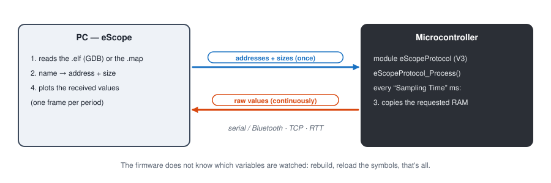

# eScope tutorials

**English** | [Français](../tutoriels/README.md)

Step by step: deploy the eScope module in a firmware, wire the board, then watch and change
variables in real time from eScope.

## Path

| # | Tutorial | Board | Link |
|---|---|---|---|
| 1 | [Getting started with eScope](01-getting-started.md) | all | all |
| 2 | [Arduino Nano](02-arduino-nano-serial.md) | Arduino Nano (ATmega328P) | USB serial 115200 |
| 3 | [STM32 NUCLEO-C051C8](03-stm32-nucleo-serial.md) | NUCLEO-C051C8 | USB serial (ST-LINK VCP) 115200 |
| 4 | [Renesas FPB-RA4E1](04-ra4e1-serial.md) | FPB-RA4E1 | SCI9 serial 115200 (+ RTT) |
| 5 | [STM32 over RTT](05-stm32-rtt.md) | NUCLEO-C051C8 | SEGGER RTT through the ST-LINK probe |
| 6 | [STM32 over Bluetooth](06-stm32-bluetooth.md) | NUCLEO-C051C8 + ESP32 | serial 115200 → Bluetooth |
| 7 | [STM32 over Wi-Fi / TCP](07-stm32-wifi-tcp.md) | NUCLEO-C051C8 + ESP32 | serial 115200 → Wi-Fi TCP |
| 8 | [Firmware simulation on PC](08-pc-simulation.md) | none (firmware as a DLL) | simulated UART → TCP |

Start with the tutorial for your board (2, 3 or 4): each one goes from the firmware to the first plot.
Tutorial 1 then details how to use eScope (channels, recording, measurements, writing variables).
Tutorials 5 to 7 reuse the STM32 board with the other links. Tutorial 8 runs the firmware on the PC,
without a board.

## Install eScope (once)

1. Install the **.NET 8 Desktop Runtime** (x64) from the Microsoft website.
2. Download the zip of the latest version from the *Releases* page of the GitHub repository and
   extract it, for example to `C:\eScope`.
3. Run `C:\eScope\eScope.exe`. The bundled GDB (`tools\gdb\bin\gdb-multiarch.exe`) is detected
   automatically: it reads the symbols of the `.elf`.

eScope saves its workspace (devices, traces, channels) to a `.escope` file, one per project: open it
with *Files > Open...*, by dropping it on the window, or with `eScope.exe project.escope`. At startup
eScope reopens the last workspace. Relative paths in the workspace (symbol file) are relative to its
folder.

For the RTT link only: Python 3 in the `PATH` and `pip install pyocd` (see
[tutorial 5](05-stm32-rtt.md)).

## Choose the link

| Link | Hardware | Useful throughput | Recommended sampling |
|---|---|---|---|
| USB serial 115200 | the board's USB cable | ~11.5 bytes/ms | 5 ms (8 floats) |
| Bluetooth | ESP32 + 3 wires | same as serial 115200 | 5 ms |
| Wi-Fi / TCP | ESP32 + 3 wires, Wi-Fi network | same as serial 115200 | 5 ms |
| RTT | SWD probe (ST-LINK, J-Link) | limited by the probe | 1 ms |

At 115200 baud the link carries about 11.5 bytes per millisecond. Each eScope frame adds 5 bytes
(header and trailer) to the data. With a 5 ms period, a frame can therefore carry about fifty bytes,
that is 8 32-bit variables. This is the value chosen in the examples. At 1 ms, even two floats do
not fit.

## Firmware examples used

| Folder | Content |
|---|---|
| [`targetExamples/arduino`](../../targetExamples/arduino) | `arduino.ino` sketch and `DebugScope` library (protocol V3) |
| [`targetExamples/stm32/NUCLEO_C051C8`](../../targetExamples/stm32/NUCLEO_C051C8) | STM32CubeIDE project, UART or RTT selected in `eScopeCfg.h` |
| [`targetExamples/ra/FPB_RA4E1`](../../targetExamples/ra/FPB_RA4E1) | e² studio project, RTT (default) or SCI9 UART |
| [`BluetoothSerialBridge`](../../BluetoothSerialBridge) | serial ↔ Bluetooth bridge for ESP32 |
| [`WifiTcpBridge`](../../WifiTcpBridge) | serial ↔ Wi-Fi TCP bridge for ESP32 |
| [`targetExamples/pcsim`](../../targetExamples/pcsim) | firmware built as a DLL (GCC, `make`) and `PcSimHost` simulator |

The screenshots in these tutorials were taken with eScope 1.3.0. The curves come from a simulator
that reproduces the variables of the examples, at the addresses of their `.elf` files.
