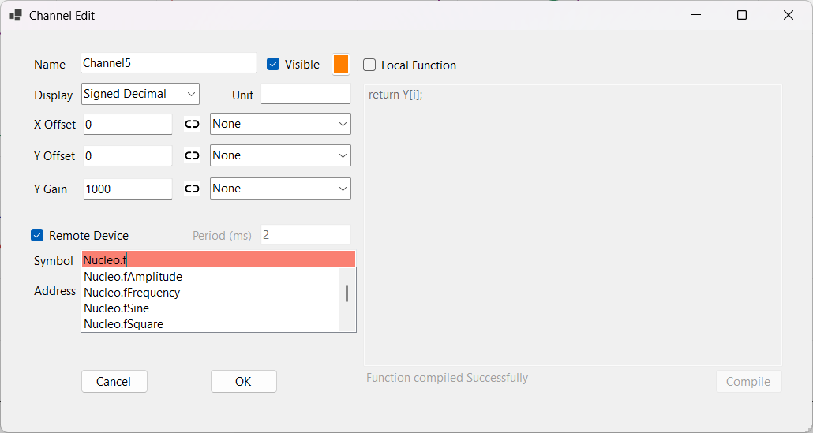
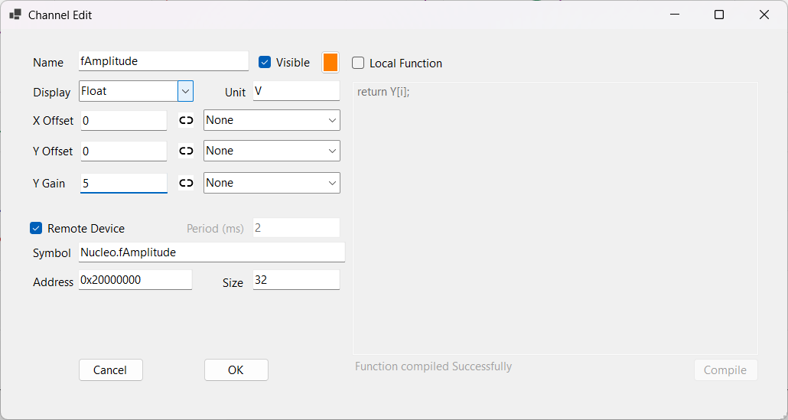
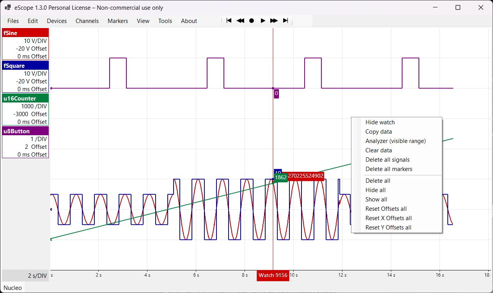
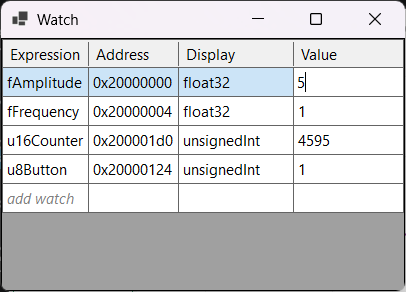
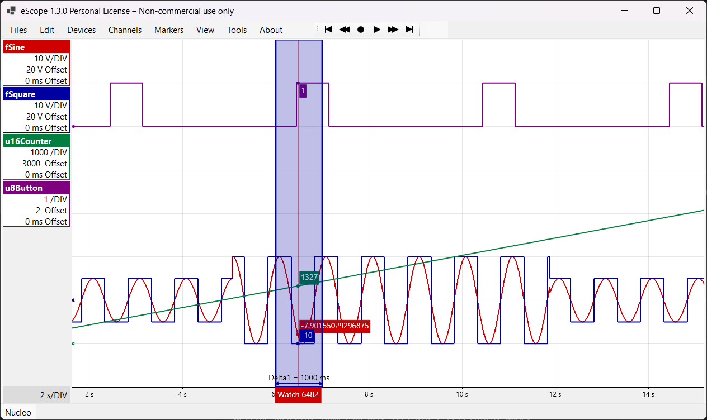

# 1. Prise en main d'eScope

Ce tutoriel suppose qu'une carte tourne avec le module eScope et qu'un **device** est déclaré
(tutoriels [2](02-arduino-nano-serie.md), [3](03-stm32-nucleo-serie.md) ou [4](04-ra4e1-serie.md)).
Les captures viennent de l'exemple NUCLEO-C051C8, dont le firmware expose :

| Variable | Type | Rôle |
|---|---|---|
| `fSine` | `float` | sinusoïde `fAmplitude · sin(2π · fFrequency · t)` |
| `fSquare` | `float` | carré de même fréquence |
| `u16Counter` | `uint16_t` | +1 à chaque période d'échantillonnage |
| `u8Button` | `uint8_t` | 1 tant que le bouton bleu USER est appuyé |
| `fAmplitude`, `fFrequency` | `float` | paramètres modifiables depuis eScope |

## La fenêtre principale

- **Menus** : *Files* (traces, export CSV / PNG), *Edit* (undo / redo, copier / coller de données),
  *Devices*, *Channels*, *Markers*, *View*, *Tools*.
- **Barre de lecture** : début, recul, **enregistrement** (●), lecture / pause, avance, fin.
- **Légende** à gauche : un cadre par channel, avec son échelle (unités par division) et ses
  décalages. Double-cliquer sur un cadre ouvre ses réglages.
- **Onglets** en bas : une trace par onglet (ici `Nucleo`).
- **Watch line** (trait rouge vertical) : suit la souris et affiche la valeur de chaque courbe.

## Ajouter un channel

*Channels > New* (touche **Inser**) ouvre la fenêtre *Channel Edit*.

1. Dans **Symbol**, taper `<device>.<variable>`, par exemple `Nucleo.f` : la liste propose les
   symboles du `.elf`. Avec les symboles GDB, toute expression C est acceptée (`ctx.cfg.gain`,
   `tab[3].x`, `*(uint16_t*)0x20000010`).

   

2. Une fois le symbole choisi, **Address** et **Size** se remplissent seuls.
3. Régler **Display** selon le type C : `Float` pour un `float`, `Unsigned Decimal` pour un
   `uint*_t`, `Signed Decimal` pour un `int*_t`. eScope ne le déduit pas : un `float` laissé en
   *Signed Decimal* donne des valeurs absurdes.
4. **Unit** (affichée dans la légende), **Y Gain** (unités par division) et **Y Offset** (décalage
   vertical) règlent l'affichage. Ils se changent aussi plus tard.
5. **OK**.

Le champ **Period (ms)** est grisé : la période vient du *Sampling Time* du device.

## Enregistrer

- **Espace** (ou le bouton ●) démarre l'enregistrement : eScope ouvre la liaison, envoie la liste
  des adresses au firmware, et les courbes défilent.
- **Espace** à nouveau l'arrête. La liaison est fermée : la carte peut être reprogrammée.

Si une trame manque ou si la carte ne répond plus, eScope le marque sur la courbe (petits repères
rouges) au lieu de relier les points.

## Naviguer

| Action | Touche |
|---|---|
| Tout afficher (zoom fit) | **Échap** |
| Zoom avant / arrière | **I** / **O** (ou ↑ / ↓) |
| Début / fin de l'enregistrement | **Ctrl+←** / **Ctrl+→** (ou **Home** / **End**) |
| Reculer / avancer d'un écran | **←** / **→** |
| Sélectionner une zone | **S**, puis **Z** pour zoomer dessus |
| Relire l'enregistrement | **P** |

Le clic droit sur le tracé ouvre le menu contextuel : copier les données, analyser, effacer les
données, masquer / afficher ou supprimer les courbes.

## Lire et écrire des variables : la fenêtre Watch

**W** ouvre la fenêtre *Watch*. Elle affiche la valeur courante de chaque expression, rafraîchie à
1 Hz pendant l'enregistrement (lectures ponctuelles, sans historique).

- Double-clic sur **add watch** pour ajouter une expression (même complétion que les channels).
- Double-clic sur une cellule **Value**, saisir la valeur, **Entrée** : la valeur est **écrite
  dans la RAM de la cible** pendant qu'elle tourne.

Le résultat sur les courbes : `fAmplitude` passée de 5 à 10 puis de nouveau à 5, sans arrêter le
programme ni recompiler.

## Mesurer

**Delta** (touche **D**, ou *Markers > New Time Delta*) : un intervalle de temps entre deux
abscisses, ici une période de `fSquare` (1000 ms).

*Markers* propose aussi des lignes horizontales (**H**) et verticales (**V**), et des textes (**T**).

**Analyseur** (touche **A**, ou clic droit > *Analyzer*) : sur la sélection, ou sur la partie
visible sans sélection, pour chaque channel, min, max, crête à crête, moyenne, RMS, écart-type,
fréquence, période, rapport cyclique et spectre FFT. Décocher **Show** retire une courbe du spectre.

## Sauvegarder

- **Ctrl+S** enregistre l'espace de travail (`eScope.json` du dossier courant) : devices, traces,
  channels, réglages et données. eScope le propose aussi à la fermeture.
- *Files > Save Trace As...* enregistre la trace courante seule (`.etrace`).
- *Files > Export Trace (CSV, PNG)...* exporte les données ou l'image.

## Après une recompilation

eScope surveille le fichier de symboles : quand le `.elf` change, il est rechargé et les adresses
des channels sont recalculées. Il suffit de reprogrammer la carte et de relancer l'enregistrement.
