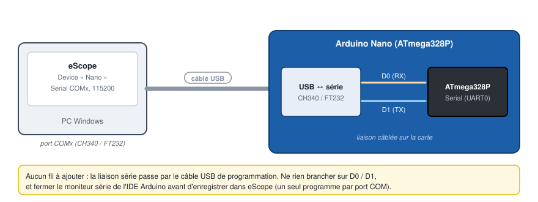
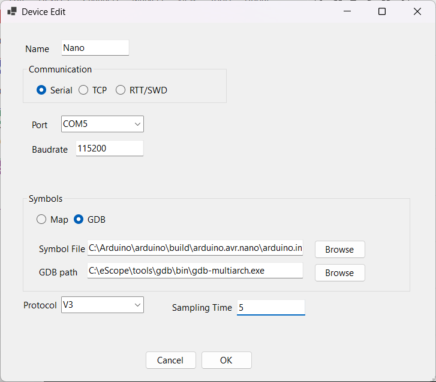

# 2. Arduino Nano en série 115200

Observer les variables d'un croquis Arduino en temps réel, par le câble USB de la carte.

| | |
|---|---|
| Carte | Arduino Nano (ATmega328P), original ou clone CH340 |
| Liaison | `Serial` (UART0) par le convertisseur USB-série de la carte, 115200 bauds |
| Protocole | V3, bibliothèque [`DebugScope`](../../targetExamples/arduino/DebugScope.h) intégrée au croquis |
| Échantillonnage | 5 ms |
| Logiciels | Arduino IDE 2, eScope |

La même bibliothèque fonctionne sur Uno, Mega, ESP32, STM32duino et SAMD (`library.properties`).

## 1. Le croquis d'exemple

Copier le dossier [`targetExamples/arduino`](../../targetExamples/arduino) : il contient le croquis
`arduino.ino` et la bibliothèque (`DebugScope.h`, `DebugScope.cpp`). Le dossier doit garder le nom
`arduino`, comme le fichier `.ino`.

L'essentiel du croquis :

```cpp
#include "DebugScope.h"

volatile float vitesse;      // variables lues par eScope : rien à déclarer de plus,
volatile float courant;      // eScope trouve leur adresse dans le .elf
int32_t position;

DebugScope scope(Serial);    // 115200 bauds (DEBUG_SCOPE_BAUDRATE)

void setup()
{
    scope.begin();
}

void loop()
{
    uint32_t now = millis();
    if (now - lastUpdate >= (uint32_t)(DEBUG_SCOPE_TS * 1000))   // toutes les 5 ms
    {
        lastUpdate += (uint32_t)(DEBUG_SCOPE_TS * 1000);
        appUpdate();         // calcule vitesse, courant, position
        scope.update();      // reçoit les commandes d'eScope, envoie une trame
    }
}
```

Le firmware ne connaît pas les variables observées : eScope envoie leurs adresses, `update()` copie
la mémoire demandée. Pour observer une autre variable de votre programme, il suffit qu'elle soit
**globale** (ou `static`) : aucune ligne à ajouter.

`DEBUG_SCOPE_TS` (dans `DebugScope.h`) fixe la période : 5 ms. À 115200 bauds, une trame de 5 ms
porte jusqu'à ~50 octets de données. À 1 ms, elle ne porte que 6 octets.

`Serial` est occupé par eScope : pas de `Serial.print` dans le croquis. Sur une Mega, utiliser
`DebugScope scope(Serial1)` pour garder `Serial` libre.

## 2. Compiler, téléverser, exporter le `.elf`

1. Ouvrir `arduino.ino` dans l'IDE Arduino.
2. *Outils > Carte > Arduino AVR Boards > Arduino Nano*. Pour beaucoup de clones :
   *Outils > Processeur > ATmega328P (Old Bootloader)*.
3. *Outils > Port* : le port COM de la carte (sur un clone : `USB-SERIAL CH340 (COMx)` dans le
   Gestionnaire de périphériques ; installer le pilote CH340 si aucun port n'apparaît).
4. **Téléverser**.
5. *Croquis > Exporter les binaires compilés*. L'IDE crée
   `build/arduino.avr.nano/arduino.ino.elf` dans le dossier du croquis : c'est le fichier de
   symboles d'eScope. Refaire cet export après chaque modification du croquis.

## 3. Câblage



Rien à câbler : le câble USB alimente la carte et porte la liaison série. **Fermer le moniteur série**
de l'IDE : un port COM ne s'ouvre que dans un programme à la fois.

## 4. Déclarer le device dans eScope

*Devices > New* :

| Champ | Valeur |
|---|---|
| Name | `Nano` |
| Communication | **Serial** |
| Port | le port COM de la carte |
| Baudrate | `115200` |
| Symbols | **GDB** |
| Symbol File | `...\build\arduino.avr.nano\arduino.ino.elf` |
| GDB path | rempli tout seul (GDB embarqué) |
| Protocol | **V3** |
| Sampling Time | `5` (la période `DEBUG_SCOPE_TS`, en ms) |



Sur AVR, GDB donne les adresses RAM avec le préfixe `0x800000` de l'espace de données
(`&vitesse` = `0x80011a`) : c'est normal, le firmware ne garde que les 16 bits utiles.

## 5. Ajouter les channels et enregistrer

*Channels > New* (touche **Inser**) pour chaque variable :

| Symbol | Display | Y Gain |
|---|---|---|
| `Nano.vitesse` | Float | 5 |
| `Nano.courant` | Float | 5 |
| `Nano.position` | Signed Decimal | 5000 |

Puis **Espace** pour enregistrer :


La suite (navigation, Watch, mesures) est décrite dans la [prise en main](01-prise-en-main.md).

## Dépannage

| Symptôme | Cause probable |
|---|---|
| Le port COM ne s'ouvre pas | moniteur série de l'IDE ouvert, ou port faux |
| Aucune courbe, pas d'erreur | croquis non téléversé, ou `Sampling Time` / baudrate différents du firmware |
| Valeurs absurdes sur un `float` | *Display* laissé en *Signed Decimal* : choisir *Float* |
| Courbes décalées après une modification du croquis | `.elf` non réexporté : refaire *Exporter les binaires compilés* |
| Erreur à l'ajout de nombreux channels | trame trop longue pour la période (`DEBUG_SCOPE_TX_MAX`) : moins de channels, ou une période plus longue |
