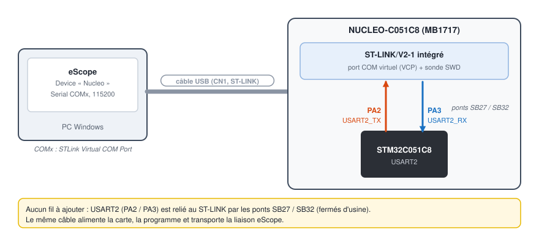

# 3. STM32 NUCLEO-C051C8 en série 115200

[English](../tutorials/03-stm32-nucleo-serial.md) | **Français**

Observer et modifier les variables d'un STM32 en temps réel, par le port COM virtuel du ST-LINK
intégré à la carte : un seul câble USB, aucun fil.

| | |
|---|---|
| Carte | NUCLEO-C051C8 (MB1717, STM32C051C8, Cortex-M0+) |
| Liaison | USART2 (PA2 / PA3) → ST-LINK → port COM virtuel, 115200 bauds |
| Protocole | V3 ([`eScopeProtocol`](../../targetExamples/eScopeProtocol)) |
| Échantillonnage | 5 ms |
| Logiciels | STM32CubeIDE, eScope |

## 1. Importer le projet d'exemple

1. Dans STM32CubeIDE : *File > Import > General > Existing Projects into Workspace*.
2. *Select root directory* : `targetExamples/stm32/NUCLEO_C051C8` du dépôt eScope.
3. **Décocher** *Copy projects into workspace* : le projet référence les dossiers
   `eScopeProtocol`, `eScopeTransport` et `SEGGER_RTT` du dépôt par un chemin relatif
   (deux niveaux au-dessus du projet). Copié ailleurs, il ne les trouve plus.

## 2. Configurer eScope dans le firmware

Toute la configuration est dans [`Core/Inc/eScopeCfg.h`](../../targetExamples/stm32/NUCLEO_C051C8/Core/Inc/eScopeCfg.h) :

```c
#define ESCOPE_PROTOCOL_V3              /* protocole complet : lecture, écriture */
#define ESCOPE_TRANSPORT_UART           /* liaison série                         */
#define ESCOPE_PROTOCOL_BAUDRATE 115200

#define ESCOPE_UART_ID  ESCOPE_UART_VCP /* USART2 PA2/PA3 = port COM du ST-LINK  */
#define ESCOPE_SAMPLING_MS  (5U)        /* = « Sampling Time » du device eScope  */
```

L'intégration dans [`Core/Src/main.c`](../../targetExamples/stm32/NUCLEO_C051C8/Core/Src/main.c)
tient en quelques lignes, toutes dans des sections `USER CODE` (conservées si CubeMX régénère le
code) :

```c
#include "eScopeProtocol.h"

static uint8_t             tu8eScopeCfg[ESCOPE_PROTOCOL_EEPROM_SIZE];
static eScopeProtocolCfg_t sProtoCfg = { .pu8Cfg = tu8eScopeCfg };
static eScopeProtocol_t    sProto;

/* dans main(), après BSP_COM_Init(COM1, ...) qui configure USART2 en 115200 8N1 */
eScopeTransportCfg_t sTransCfg = { .u8Id = ESCOPE_UART_ID };
eScopeProtocol_Init(&sProto, &sTransCfg, &sProtoCfg);

uint32_t u32LastTick = HAL_GetTick();
while (1)
{
    eScopeProtocol_Poll(&sProto);
    if ((HAL_GetTick() - u32LastTick) >= ESCOPE_SAMPLING_MS)
    {
        u32LastTick += ESCOPE_SAMPLING_MS;
        App_Update();                     /* l'application : calcule fSine, fSquare… */
        eScopeProtocol_Process(&sProto);  /* envoie une trame                       */
    }
}

/* réception : un octet par interruption */
void HAL_UART_RxCpltCallback(UART_HandleTypeDef* huart)
{
    eScopeTransportUartStm32_RxCallback(&sProto.sTransport, huart);
}
```

Les gestionnaires `USART2_IRQHandler` / `USART1_IRQHandler` sont dans `stm32c0xx_it.c`, le
transport HAL dans `Core/Src/eScopeTransportUart.c`. La période d'appel de
`eScopeProtocol_Process()` est la période d'échantillonnage : elle doit être régulière.

## 3. Compiler, programmer

1. *Project > Build Project* : produit `Debug/NUCLEO_C051C8.elf`, le fichier de symboles d'eScope.
2. Brancher la carte, *Run > Run* : le ST-LINK programme le STM32 et le programme démarre.

## 4. Câblage



Rien à câbler. Dans le Gestionnaire de périphériques, la carte apparaît comme
**STMicroelectronics STLink Virtual COM Port (COMx)** (pilote installé avec STM32CubeIDE).

## 5. Déclarer le device dans eScope

*Devices > New* :

| Champ | Valeur |
|---|---|
| Name | `Nucleo` |
| Communication | **Serial**, port `COMx` du ST-LINK, baudrate `115200` |
| Symbols | **GDB**, Symbol File `...\NUCLEO_C051C8\Debug\NUCLEO_C051C8.elf` |
| Protocol | **V3** |
| Sampling Time | `5` (`ESCOPE_SAMPLING_MS`) |


## 6. Channels, enregistrement, écriture

*Channels > New* (touche **Inser**) :

| Symbol | Display | Unit | Y Gain |
|---|---|---|---|
| `Nucleo.fSine` | Float | V | 10 |
| `Nucleo.fSquare` | Float | V | 10 |
| `Nucleo.u16Counter` | Unsigned Decimal | | 1000 |
| `Nucleo.u8Button` | Unsigned Decimal | | 1 |

**Espace** lance l'enregistrement. Appuyer sur le bouton bleu **USER** : `u8Button` passe à 1.


**W** ouvre la Watch : ajouter `fAmplitude` et `fFrequency`, puis double-cliquer sur leur valeur pour
la modifier. Le firmware lit ces variables à chaque période : la sinusoïde change aussitôt.


Toutes les fonctions d'eScope sont détaillées dans la [prise en main](01-prise-en-main.md).

## Intégrer eScope dans votre propre projet STM32

1. Ajouter au projet les dossiers `targetExamples/eScopeProtocol` et `targetExamples/eScopeTransport`
   (dossiers liés ou copiés) et les mettre dans les chemins d'inclusion.
2. Copier dans votre projet `eScopeCfg.h`, `eScopeDep.h` (section critique par PRIMASK, valable sur
   tout Cortex-M) et `eScopeTransportUart.c`. Adapter dans ce dernier la correspondance
   `u8Id` → `UART_HandleTypeDef`.
3. Activer l'interruption de l'UART choisi et appeler `HAL_UART_IRQHandler()` depuis son
   gestionnaire.
4. Appeler `eScopeProtocol_Init()` après l'initialisation de l'UART, puis `eScopeProtocol_Poll()` et
   `eScopeProtocol_Process()` à période fixe comme ci-dessus.
5. Router `HAL_UART_RxCpltCallback()` vers `eScopeTransportUartStm32_RxCallback()`.

## Dépannage

| Symptôme | Cause probable |
|---|---|
| Pas de port COM ST-LINK | pilote ST-LINK absent (installé avec STM32CubeIDE), ou câble USB de charge seule |
| Le build ne trouve pas `eScopeProtocol.h` | projet copié dans le workspace : réimporter sans *Copy projects into workspace* |
| Aucune donnée | baudrate différent du firmware, ou programme arrêté par le débogueur (point d'arrêt sur `main`) |
| Axe des temps faux | `Sampling Time` différent de `ESCOPE_SAMPLING_MS` |
| Courbes en dents de scie inattendues | `float` affiché en *Signed Decimal* : choisir *Float* |
