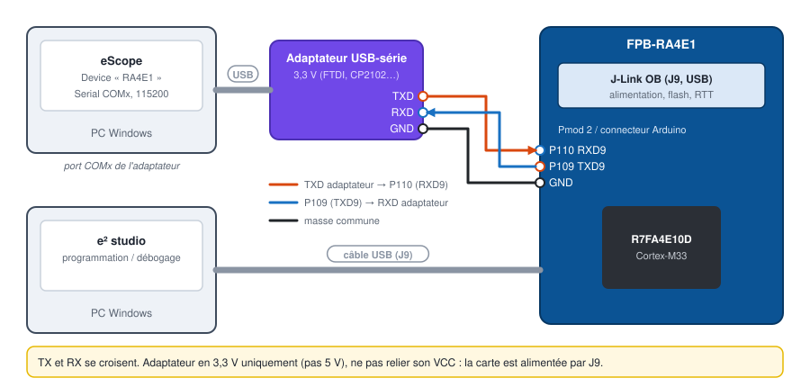
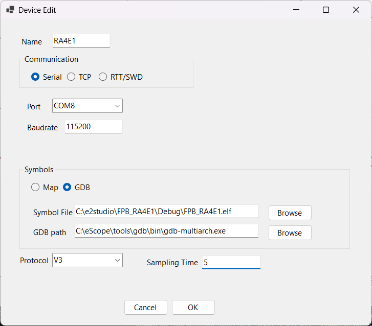
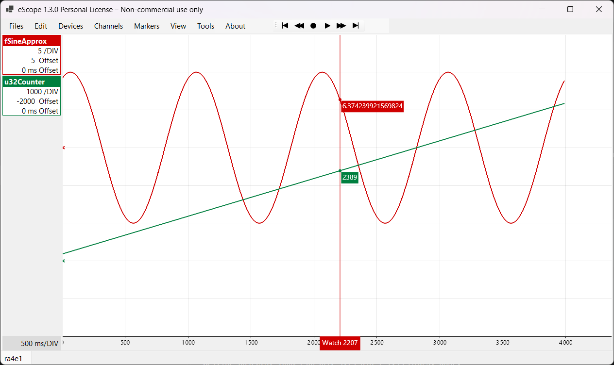
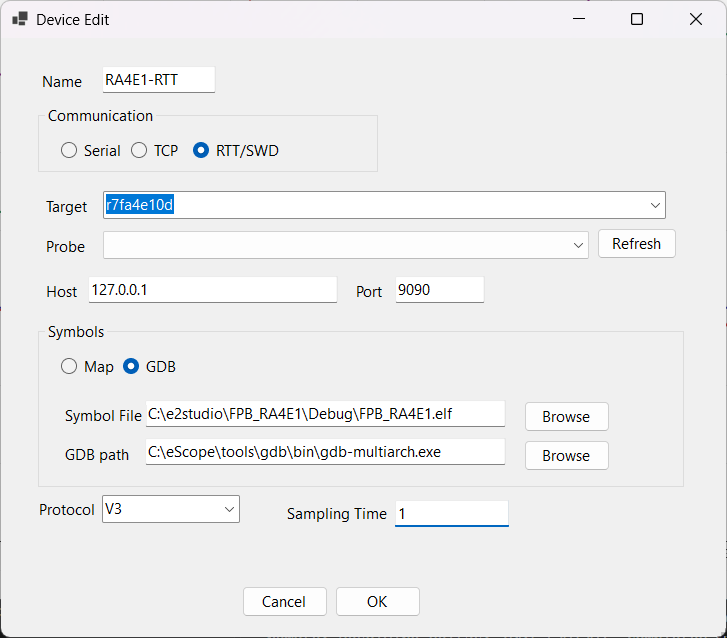

# 4. Renesas FPB-RA4E1 en série 115200

[English](../tutorials/04-ra4e1-serial.md) | **Français**

Observer les variables d'un Renesas RA4E1 par une liaison série 115200 bauds sur SCI9, avec un
adaptateur USB-série. Le même projet fonctionne aussi en RTT par la sonde J-Link intégrée, sans
adaptateur (section 7).

| | |
|---|---|
| Carte | FPB-RA4E1 (R7FA4E10D, Cortex-M33), J-Link OB intégré |
| Liaison | SCI9 : P109 = TXD9, P110 = RXD9, 115200 bauds, adaptateur USB-série **3,3 V** |
| Protocole | V3Id ([`eScopeProtocolV3Id`](../../targetExamples/eScopeProtocol/eScopeProtocolV3Id.h)) : V3 avec la configuration dans une structure ; côté eScope, protocole **V3** |
| Échantillonnage | 5 ms en série, 1 ms en RTT |
| Logiciels | e² studio avec FSP, eScope |

## 1. Importer le projet d'exemple

1. Dans e² studio : *File > Import > General > Existing Projects into Workspace*.
2. *Select root directory* : `targetExamples/ra/FPB_RA4E1` du dépôt eScope.
3. **Décocher** *Copy projects into workspace* : le projet référence `eScopeProtocol`,
   `eScopeTransport` et `SEGGER_RTT` du dépôt par un chemin relatif.

Le firmware ([`src/hal_entry.c`](../../targetExamples/ra/FPB_RA4E1/src/hal_entry.c)) fait clignoter
la LED et expose deux variables :

```c
volatile uint32_t u32Counter;   /* +1 par période                   */
volatile float    fSineApprox;  /* 10 · sin(2π · 1 Hz · t)          */
```

## 2. Ajouter l'UART SCI9 dans le FSP

Ouvrir `configuration.xml` (*FSP Configuration*) :

1. Onglet **Stacks** : *New Stack > Connectivity > UART (r_sci_uart)*. Dans les propriétés :

   | Propriété | Valeur |
   |---|---|
   | Name | `g_uart9` |
   | Channel | `9` |
   | Baud Rate | `115200` |
   | Data Bits / Parity / Stop Bits | 8 / None / 1 |
   | Callback | `eScope_uart_callback` |

2. Onglet **Pins** : *Peripherals > Connectivity:SCI > SCI9*, mode *Asynchronous UART*,
   TXD9 = **P109**, RXD9 = **P110**.
3. **Generate Project Content**.

Les noms `g_uart9` et `eScope_uart_callback` sont ceux qu'attend le transport
[`src/eScopeTransportUart.c`](../../targetExamples/ra/FPB_RA4E1/src/eScopeTransportUart.c).

## 3. Choisir le transport UART

Dans [`src/eScopeCfg.h`](../../targetExamples/ra/FPB_RA4E1/src/eScopeCfg.h), commenter RTT et
activer UART :

```c
/* #define ESCOPE_TRANSPORT_RTT */
   #define ESCOPE_TRANSPORT_UART    /* SCI9 P109/P110, stack FSP g_uart9 */
```

`ESCOPE_SAMPLING_MS` passe alors à 5 ms : `hal_entry.c` appelle `eScopeProtocol_Process()` à cette
période (`R_BSP_SoftwareDelay`).

## 4. Compiler, programmer

1. *Project > Build Project* : produit `Debug/FPB_RA4E1.elf`.
2. Brancher la carte par **J9** (J-Link OB), puis *Run > Debug* (ou *Run*) : e² studio programme le
   RA4E1. En session de debug, reprendre l'exécution (**F8**) : arrêté, le programme n'envoie rien.

## 5. Câblage



| Adaptateur USB-série | FPB-RA4E1 |
|---|---|
| TXD | **P110** (RXD9) |
| RXD | **P109** (TXD9) |
| GND | GND |
| VCC | ne pas relier |

P109 / P110 sont sur le connecteur Pmod 2 et sur le connecteur Arduino de la carte (voir le
*FPB-RA4E1 User's Manual*). L'adaptateur doit être en **3,3 V**.

## 6. Déclarer le device dans eScope

| Champ | Valeur |
|---|---|
| Name | `RA4E1` |
| Communication | **Serial**, port COM de l'adaptateur, baudrate `115200` |
| Symbols | **GDB**, Symbol File `...\FPB_RA4E1\Debug\FPB_RA4E1.elf` |
| Protocol | **V3** |
| Sampling Time | `5` |



Channels : `RA4E1.fSineApprox` (Float, Y Gain 5) et `RA4E1.u32Counter` (Unsigned Decimal,
Y Gain 1000). **Espace** pour enregistrer :



## 7. Variante RTT (configuration d'origine du projet)

Sans adaptateur ni fil, eScope lit la RAM par la sonde J-Link OB (même principe qu'au
[tutoriel 5](05-stm32-rtt.md)) :

1. `eScopeCfg.h` : `ESCOPE_TRANSPORT_RTT` (réglage livré), `ESCOPE_SAMPLING_MS` = 1.
2. Sur le PC : Python 3, `pip install pyocd` puis `pyocd pack install r7fa4e10d`. Avec le logiciel
   SEGGER J-Link installé, `pip install pylink-square` fait utiliser le RTT natif du J-Link
   (automatique).
3. Device eScope : **RTT/SWD**, Target `r7fa4e10d`, Probe = le J-Link OB (*Refresh* pour la liste),
   Sampling Time `1`.



Fermer la session de debug d'e² studio avant d'enregistrer : la sonde ne sert qu'à un programme à la
fois.

## Dépannage

| Symptôme | Cause probable |
|---|---|
| Erreurs de compilation `g_uart9` inconnu | stack r_sci_uart absent ou nommé autrement, ou contenu FSP non régénéré |
| Aucune donnée en série | TX / RX non croisés, masse non reliée, ou programme arrêté dans le débogueur |
| Caractères perdus | adaptateur en 5 V, ou `Sampling Time` trop court pour le nombre de channels |
| RTT : « no probe » | session de debug e² studio encore ouverte, ou pack pyOCD non installé |
