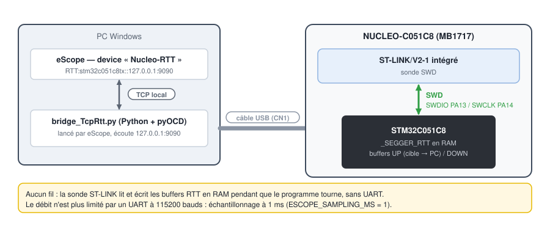

# 5. STM32 NUCLEO-C051C8 en RTT

[English](../tutorials/05-stm32-rtt.md) | **Français**

Remplacer la liaison série par **SEGGER RTT** : eScope lit et écrit des buffers en RAM du STM32
par la sonde SWD du ST-LINK, pendant que le programme tourne. Pas d'UART, pas de fil, et un débit
qui n'est plus limité à 115200 bauds : échantillonnage à 1 ms.

Prérequis : le [tutoriel 3](03-stm32-nucleo-serie.md) (projet importé, compilé, programmé).

## Principe



- Le firmware déclare le bloc de contrôle `_SEGGER_RTT` et deux buffers circulaires en RAM
  (sources SEGGER dans [`targetExamples/SEGGER_RTT`](../../targetExamples/SEGGER_RTT)).
- eScope lance `bridge_TcpRtt.py` (livré à côté d'`eScope.exe`) : ce script Python pilote la sonde
  avec **pyOCD**, et échange les données avec eScope par TCP sur `127.0.0.1:9090`.
- eScope cherche l'adresse de `_SEGGER_RTT` dans le `.elf` et la donne au bridge : pas de
  recherche en RAM.

## 1. Installer pyOCD (une fois)

```powershell
python --version                     # Python 3 dans le PATH
pip install pyocd
pyocd pack install stm32c051c8tx     # description de la cible (télécharge le pack ST)
python -m pyocd list --probes        # la carte branchée doit apparaître
```

## 2. Passer le firmware en RTT

Dans [`Core/Inc/eScopeCfg.h`](../../targetExamples/stm32/NUCLEO_C051C8/Core/Inc/eScopeCfg.h) :

```c
/* #define ESCOPE_TRANSPORT_UART */
   #define ESCOPE_TRANSPORT_RTT     /* SEGGER RTT par le ST-LINK (SWD) */
```

`ESCOPE_SAMPLING_MS` passe automatiquement à 1 ms. Le reste du code ne change pas : la même
structure `{ .u8Id = 0 }` désigne le canal RTT 0, et `eScopeProtocol_Poll()` lit le buffer descendant
(PC → cible) à chaque tour de boucle.

Le projet compile déjà `SEGGER_RTT.c` (dossier lié `SEGGER_RTT`, dans les chemins d'inclusion).
Recompiler, programmer (*Run > Run*), et **terminer toute session de debug** : la sonde ne sert qu'à
un programme à la fois.

## 3. Câblage

Aucun : le câble USB du ST-LINK porte le SWD (PA13 / PA14, reliés sur la carte).

## 4. Déclarer le device dans eScope

*Devices > New* :

| Champ | Valeur |
|---|---|
| Name | `Nucleo-RTT` |
| Communication | **RTT/SWD** |
| Target | `stm32c051c8tx` (liste des cibles pyOCD, saisie avec complétion) |
| Probe | le ST-LINK (*Refresh* pour relire la liste) ; vide = sonde unique choisie seule |
| Host / Port | `127.0.0.1` / `9090` |
| Symbols | **GDB**, `...\Debug\NUCLEO_C051C8.elf` |
| Protocol | **V3** |
| Sampling Time | `1` |


À l'enregistrement (**Espace**), eScope démarre le bridge, attend qu'il soit prêt, puis s'y
connecte. À l'arrêt, il le ferme. Les channels se créent comme en série
([tutoriel 3](03-stm32-nucleo-serie.md#6-channels-enregistrement-écriture)), la Watch et l'écriture
de variables fonctionnent de la même façon.

## Pour aller plus loin

- **Sonde J-Link** : avec le logiciel SEGGER installé et `pip install pylink-square`, le bridge
  utilise le RTT natif du J-Link (choix automatique).
- **Bridge sur une autre machine** : mettre l'adresse de cette machine dans *Host* ; eScope s'y
  connecte au lieu de lancer le bridge. Le lancer à la main :
  `python bridge_TcpRtt.py --target stm32c051c8tx --host 0.0.0.0 --port 9090`.
- **Une autre carte** : n'importe quelle cible Cortex-M connue de pyOCD
  (`python -m pyocd list --targets`), avec `ESCOPE_TRANSPORT_RTT` dans son `eScopeCfg.h` et
  `eScopeProtocol_Poll()` avant `eScopeProtocol_Process()`.

## Dépannage

| Symptôme | Cause probable |
|---|---|
| Liste *Target* vide | Python ou pyOCD absent du `PATH` |
| Liste *Probe* vide | carte débranchée, ou session de debug STM32CubeIDE ouverte |
| Le bridge démarre mais aucune donnée | firmware encore en `ESCOPE_TRANSPORT_UART`, ou adresse `_SEGGER_RTT` périmée : elle est lue dans le `.elf` au clic sur **OK** du device ; après une recompilation qui la déplace, rouvrir le device et valider |
| Port 9090 occupé | un autre bridge tourne : le fermer, ou changer *Port* |
