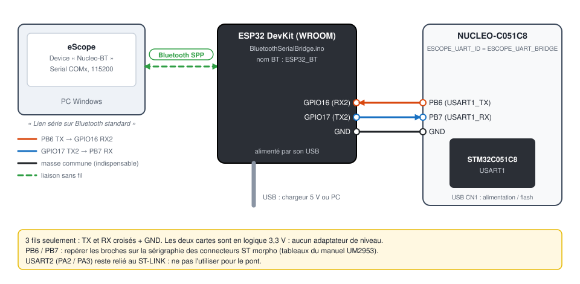
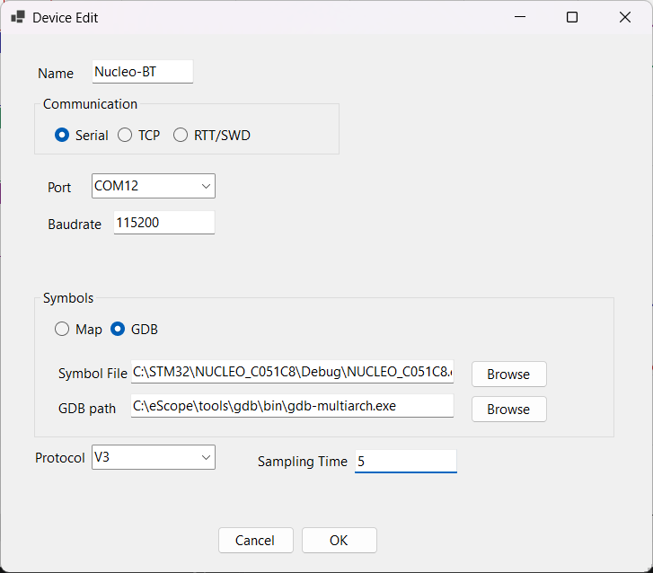

# 6. STM32 NUCLEO-C051C8 en Bluetooth

[English](../tutorials/06-stm32-bluetooth.md) | **Français**

Observer la carte **sans câble vers le PC** : un ESP32 relaie la liaison série 115200 bauds du
STM32 en Bluetooth. Côté PC, le Bluetooth apparaît comme un port COM : eScope le voit comme une
liaison série ordinaire.

Prérequis : le [tutoriel 3](03-stm32-nucleo-serie.md) (projet importé, compilé, programmé).

| | |
|---|---|
| Matériel | NUCLEO-C051C8, ESP32 DevKit (module WROOM, ESP32 « classique »), 3 fils |
| Liaison STM32 ↔ ESP32 | USART1 : PB6 (TX), PB7 (RX), 115200 bauds 8N1, 3,3 V |
| Liaison ESP32 ↔ PC | Bluetooth Classic, profil série (SPP), nom `ESP32_BT` |
| Pont | [`BluetoothSerialBridge.ino`](../../BluetoothSerialBridge/BluetoothSerialBridge.ino) |

Le Bluetooth Classic n'existe que sur l'ESP32 d'origine : un ESP32-S3, -C3 ou -C6 (Bluetooth Low
Energy seulement) ne convient pas.

## 1. Firmware STM32 : utiliser USART1

USART2 (PA2 / PA3) est relié au ST-LINK : un pont externe sur ces broches entrerait en conflit avec
lui. L'exemple prévoit donc un second UART, USART1 sur PB6 / PB7. Dans
[`Core/Inc/eScopeCfg.h`](../../targetExamples/stm32/NUCLEO_C051C8/Core/Inc/eScopeCfg.h) :

```c
#define ESCOPE_TRANSPORT_UART
#define ESCOPE_UART_ID  ESCOPE_UART_BRIDGE   /* USART1 PB6 (TX) / PB7 (RX) */
```

`main.c` initialise alors USART1 (`MX_USART1_UART_Init()`, broches configurées dans
`HAL_UART_MspInit()` de `stm32c0xx_hal_msp.c`). Recompiler et programmer la carte.

## 2. Programmer l'ESP32

1. Dans l'IDE Arduino, installer la plateforme ESP32 : *Fichier > Préférences > URL de gestionnaire
   de cartes supplémentaires* :
   `https://espressif.github.io/arduino-esp32/package_esp32_index.json`, puis
   *Outils > Carte > Gestionnaire de carte* : **esp32** (Espressif Systems).
2. Ouvrir `BluetoothSerialBridge/BluetoothSerialBridge.ino`.
3. *Outils > Carte > esp32 > ESP32 Dev Module*, choisir le port de l'ESP32, **Téléverser**.

Le croquis relaie dans les deux sens UART2 (GPIO16 = RX2, GPIO17 = TX2, 115200 bauds) et le
Bluetooth (`SerialBT.begin("ESP32_BT")`). Il recopie aussi le trafic sur le port USB de l'ESP32,
pour le débogage. La LED bleue (GPIO2) s'allume quand des données arrivent par l'USB.

## 3. Câblage



| NUCLEO-C051C8 | ESP32 DevKit |
|---|---|
| PB6 (USART1_TX) | GPIO16 (RX2) |
| PB7 (USART1_RX) | GPIO17 (TX2) |
| GND | GND |

- TX va sur RX et inversement.
- La masse commune est indispensable.
- Les deux cartes sont en 3,3 V : pas d'adaptateur de niveau.
- PB6 et PB7 sont sur les connecteurs ST morpho : repérer les broches sur la sérigraphie ou dans les
  tableaux de connecteurs du manuel de la carte (UM2953).

Alimentation : la Nucleo par son USB (ou une alimentation externe), l'ESP32 par son USB (chargeur
5 V, batterie ou PC).

## 4. Appairer l'ESP32 avec Windows

*Paramètres > Bluetooth et appareils > Ajouter un appareil > Bluetooth* : choisir **ESP32_BT**.

Windows crée souvent deux ports par appareil (entrant et sortant) : seul le sortant permet à eScope
d'ouvrir la connexion. Dans la liste des ports d'eScope, le port sortant porte le nom de l'appareil,
`COMx (ESP32_BT)`, et les ports entrants sont marqués `(Bluetooth incoming)`.

## 5. Déclarer le device dans eScope

| Champ | Valeur |
|---|---|
| Name | `Nucleo-BT` |
| Communication | **Serial**, port `COMx (ESP32_BT)`, baudrate `115200` |
| Symbols | **GDB**, `...\Debug\NUCLEO_C051C8.elf` |
| Protocol | **V3** |
| Sampling Time | `5` |



**Espace** : à l'ouverture du port, Windows établit la connexion Bluetooth (une à deux secondes),
puis les courbes arrivent comme en série USB ([tutoriel 3](03-stm32-nucleo-serie.md#6-channels-enregistrement-écriture)).
Le débit reste celui de l'UART à 115200 bauds. Le Bluetooth ajoute un peu de latence, sans effet
sur l'axe des temps : eScope place chaque trame à sa position (une trame par *Sampling Time*), pas à
son heure d'arrivée.

## Dépannage

| Symptôme | Cause probable |
|---|---|
| `ESP32_BT` introuvable | ESP32 non alimenté, croquis non téléversé, ou ESP32 sans Bluetooth Classic |
| Le port COM ne s'ouvre pas | port **entrant** choisi au lieu du sortant, ou ESP32 hors de portée |
| Connexion établie, aucune donnée | TX / RX non croisés, GND non relié, ou firmware STM32 resté en `ESCOPE_UART_VCP` |
| Données hachées | portée Bluetooth limite, ou `Sampling Time` trop court pour le nombre de channels |
