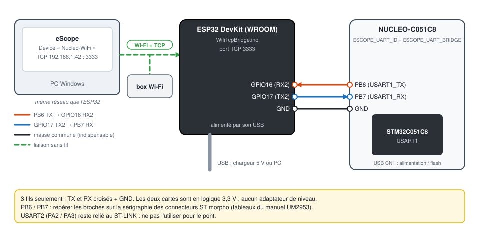
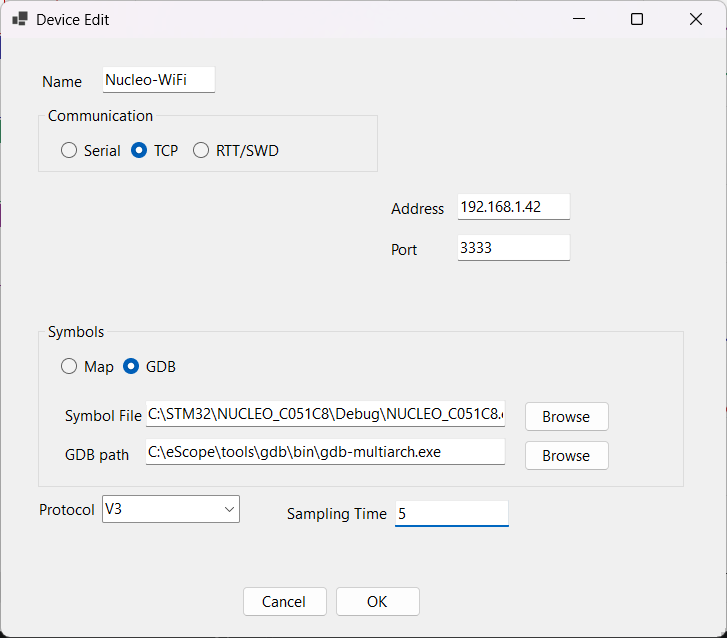

# 7. STM32 NUCLEO-C051C8 en Wi-Fi / TCP

[English](../tutorials/07-stm32-wifi-tcp.md) | **Français**

Observer la carte à travers le réseau : un ESP32 relaie la liaison série 115200 bauds du STM32 sur
une connexion TCP en Wi-Fi. eScope s'y connecte avec la liaison **TCP**.

Prérequis : le [tutoriel 3](03-stm32-nucleo-serie.md) (projet importé, compilé, programmé). Le
câblage est celui du [tutoriel 6](06-stm32-bluetooth.md) : seul le croquis de l'ESP32 change.

| | |
|---|---|
| Matériel | NUCLEO-C051C8, ESP32 DevKit (tout ESP32 avec Wi-Fi), 3 fils, réseau Wi-Fi 2,4 GHz |
| Liaison STM32 ↔ ESP32 | USART1 : PB6 (TX), PB7 (RX), 115200 bauds 8N1, 3,3 V |
| Liaison ESP32 ↔ PC | TCP, port 3333, un client à la fois |
| Pont | [`WifiTcpBridge.ino`](../../WifiTcpBridge/WifiTcpBridge.ino) |

Le NUCLEO-C051C8 n'a pas d'interface réseau : l'ESP32 joue le rôle de passerelle série ↔ TCP.
Une carte avec Ethernet ou Wi-Fi intégré pourrait implémenter le transport TCP directement
(`ESCOPE_TRANSPORT_TCP`, squelette dans
[`eScopeTransportTcp.c`](../../targetExamples/eScopeTransport/eScopeTransportTcp.c)).

## 1. Firmware STM32 : utiliser USART1

Comme pour le Bluetooth, dans `Core/Inc/eScopeCfg.h` :

```c
#define ESCOPE_TRANSPORT_UART
#define ESCOPE_UART_ID  ESCOPE_UART_BRIDGE   /* USART1 PB6 (TX) / PB7 (RX) */
```

Recompiler et programmer la carte.

## 2. Programmer l'ESP32

1. Installer la plateforme **esp32** dans l'IDE Arduino (voir le
   [tutoriel 6](06-stm32-bluetooth.md#2-programmer-lesp32)).
2. Ouvrir `WifiTcpBridge/WifiTcpBridge.ino` et renseigner le réseau :

   ```cpp
   const char* WIFI_SSID     = "your-ssid";
   const char* WIFI_PASSWORD = "your-password";
   const uint16_t TCP_PORT   = 3333;
   ```

3. *Outils > Carte > esp32 > ESP32 Dev Module*, **Téléverser**.
4. Ouvrir le moniteur série (115200 bauds) et appuyer sur **EN** (reset) de l'ESP32 : il affiche son
   adresse, par exemple `eScope TCP bridge ready: 192.168.1.42:3333`. Fermer le moniteur.

Pour que l'adresse ne change pas, réserver une adresse fixe à l'ESP32 dans la box (bail DHCP
statique).

Le croquis relaie dans les deux sens UART2 (GPIO16 / GPIO17) et le client TCP. La LED (GPIO2)
reste allumée tant qu'eScope est connecté. Un nouveau client remplace le précédent.

## 3. Câblage



| NUCLEO-C051C8 | ESP32 DevKit |
|---|---|
| PB6 (USART1_TX) | GPIO16 (RX2) |
| PB7 (USART1_RX) | GPIO17 (TX2) |
| GND | GND |

TX et RX croisés, masse commune, tout en 3,3 V. L'ESP32 peut être alimenté par un simple chargeur
USB : il n'a plus besoin du PC.

## 4. Déclarer le device dans eScope

| Champ | Valeur |
|---|---|
| Name | `Nucleo-WiFi` |
| Communication | **TCP**, Address = l'adresse affichée par l'ESP32, Port `3333` |
| Symbols | **GDB**, `...\Debug\NUCLEO_C051C8.elf` |
| Protocol | **V3** |
| Sampling Time | `5` |



**Espace** : eScope ouvre la connexion TCP, la LED de l'ESP32 s'allume et les courbes arrivent comme
en série ([tutoriel 3](03-stm32-nucleo-serie.md#6-channels-enregistrement-écriture)). Le PC et
l'ESP32 doivent être sur le même réseau (ou routés l'un vers l'autre) ; la connexion part du PC,
aucune règle entrante n'est à ouvrir dans le pare-feu Windows.

## Dépannage

| Symptôme | Cause probable |
|---|---|
| L'ESP32 affiche des points sans fin | SSID / mot de passe faux, ou réseau 5 GHz uniquement |
| eScope ne se connecte pas | adresse IP changée (réserver une adresse fixe), PC sur un autre réseau ou réseau invité isolé |
| Connecté (LED allumée), aucune donnée | TX / RX non croisés, GND non relié, ou firmware STM32 resté en `ESCOPE_UART_VCP` |
| Coupures | Wi-Fi faible : rapprocher l'ESP32 du point d'accès |
