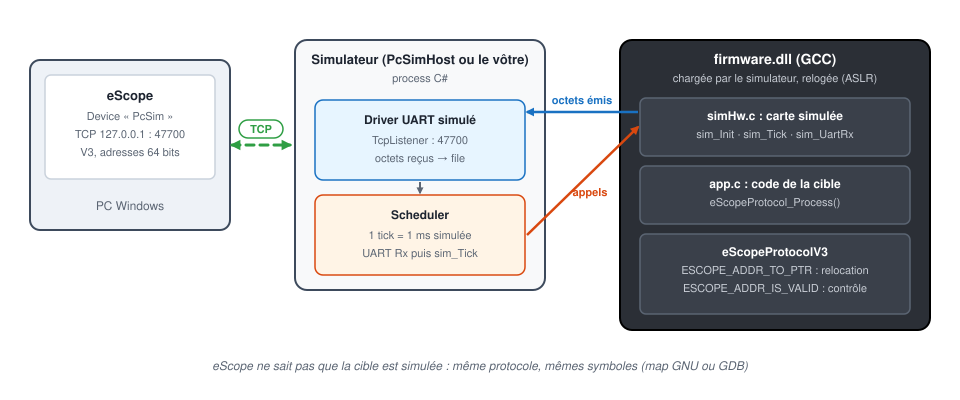

# 8. Simulation du firmware sur PC

[English](../tutorials/08-pc-simulation.md) | **Français**

Observer un firmware qui tourne **sur le PC**, sans carte : le code de la cible est compilé en DLL avec
GCC et exécuté par un simulateur qui simule la carte (timer, UART…). eScope s'y connecte en **TCP**
comme à une vraie cible : même protocole V3, mêmes symboles, mêmes traces.

Prérequis : le [tutoriel 1](01-prise-en-main.md) pour l'utilisation d'eScope.

| | |
|---|---|
| Matériel | aucun : un PC Windows |
| Outils | [MSYS2](https://www.msys2.org/) avec les paquets `mingw-w64-ucrt-x86_64-gcc` et `make`, SDK .NET 8 |
| Liaison simulateur ↔ PC | TCP `127.0.0.1:47700`, un client à la fois |
| Exemple | [`targetExamples/pcsim`](../../targetExamples/pcsim) : firmware, simulateur `PcSimHost`, `Makefile`, `eScope.json` |



Le firmware garde son transport **UART** : c'est le **driver UART du simulateur** qui relaie les octets
vers un socket TCP. Ni le firmware ni eScope ne voient la différence avec une liaison série.

## 1. Installer la chaîne de compilation

1. Installer MSYS2, par exemple dans `C:\msys64`.
2. Ouvrir le shell **MSYS2 UCRT64** et installer GCC et make :

   ```sh
   pacman -S mingw-w64-ucrt-x86_64-gcc make
   ```

3. Installer le **SDK .NET 8** (pour compiler le simulateur `PcSimHost`).

## 2. Compiler le firmware et le simulateur

Dans le shell MSYS2 UCRT64, depuis le dossier de l'exemple :

```sh
cd /c/chemin/vers/eScope/targetExamples/pcsim
make
```

| Fichier produit | Rôle |
|---|---|
| `build/firmware.dll` | le firmware : `app.c` (le code de la cible), `simHw.c` (la carte simulée), eScopeProtocolV3 |
| `build/firmware.map` | les symboles pour eScope (map GNU, avec la taille des variables) |
| `build/PcSimHost.exe` | le simulateur : charge la DLL, l'exécute en temps simulé, relaie son UART en TCP |

`make firmware` ne recompile que la DLL, `make clean` efface `build/`. Si `dotnet` n'est pas trouvé
depuis MSYS2, donner son chemin : `make DOTNET=/c/Program\ Files/dotnet/dotnet.exe`.

## 3. Lancer le simulateur

```sh
./build/PcSimHost.exe
```

```
firmware ...\build\firmware.dll loaded at 0x7FFA47A30000, eScope UART on TCP 127.0.0.1:47700, speed x1
Ctrl+C to stop
```

L'adresse de chargement change à chaque lancement (ASLR de Windows) : c'est normal, le firmware traduit
lui-même les adresses (voir [Adresses 64 bits et relocation](#7-adresses-64-bits-et-relocation)).

Options : `--port 47700`, `--speed 5` (simulation 5 fois plus rapide que le temps réel), et le chemin
d'une autre DLL.

## 4. Déclarer le device dans eScope

Le plus simple : lancer eScope **depuis le dossier `targetExamples/pcsim`**, il charge `eScope.json` et
le device `PcSim` est prêt. Pour le déclarer à la main :

| Champ | Valeur |
|---|---|
| Name | `PcSim` |
| Communication | **TCP**, Address `127.0.0.1`, Port `47700` |
| Symbols | **Map**, `...\targetExamples\pcsim\build\firmware.map` (ou **GDB** sur `firmware.dll`) |
| Protocol | **V3** |
| Addresses | **64 bits** |
| Sampling Time | `1` |

**Addresses: 64 bits** est indispensable : la DLL est un binaire x64 dont les variables sont au-delà de
4 Go (`0x180003130`…). Avec 32 bits, le firmware répond une erreur et eScope affiche dans le journal
« the device expects 64 bits addresses ».

Avec **GDB**, eScope lit les informations de debug (DWARF, option `-g` du `Makefile`) : types, tailles,
membres de structures et expressions C, comme avec un `.elf`.

## 5. Channels, enregistrement, écriture

Ajouter les channels `motor_speed`, `motor_current` et `led_state`, puis enregistrer (**Ctrl+Espace**) :


| Variable | Contenu |
|---|---|
| `motor_speed` | `1000 * sin(2π·50 Hz·t)`, int16 |
| `motor_current` | `motor_cfg * 10 + 5 * sin(2π·5 Hz·t)`, int16 |
| `motor_cfg` | uint32, 7 au démarrage, à écrire depuis le Watch |
| `led_state` | créneau 10 Hz, rapport cyclique 30 % (0 / 100) |

Écrire `motor_cfg` depuis le Watch (par exemple 40) : `motor_current` passe autour de 400.

## 6. Temps simulé

Il n'y a pas d'horodatage, comme sur une cible : l'axe du temps d'eScope est la **cadence
d'échantillonnage**, une trame par appel de `eScopeProtocol_Process()`. Ici, `app.c` l'appelle à chaque
tick de 1 ms simulée, d'où **Sampling Time = 1**.

- `--speed 5` : une seconde d'enregistrement contient cinq secondes de simulation. Le signal à 50 Hz
  reste à 50 Hz sur l'axe d'eScope.
- Simulation en pause (point d'arrêt dans le simulateur) : plus de trames, eScope signale une perte de
  communication (timeout) puis reprend tout seul.

## 7. Adresses 64 bits et relocation

eScope envoie les adresses **de link**, lues dans le map ou par GDB. Windows charge la DLL ailleurs (ASLR).
La traduction est faite côté firmware, dans `firmware/eScopeCfg.h`, sans que eScope ait à le savoir :

```c
#define ESCOPE_PROTOCOL_ADDRESS_SIZE  (8U)      /* eScope : "Addresses: 64 bits" */

extern char __ImageBase;                       /* base de chargement réelle de la DLL */
#define ESCOPE_ADDR_TO_PTR(addr) \
    ((uint8_t*)((uintptr_t)&__ImageBase + (uintptr_t)((addr) - SIM_LINK_BASE)))

bool simHw_IsValid(const uint8_t* pu8, uint32_t u32Size);
#define ESCOPE_ADDR_IS_VALID(ptr, size)  simHw_IsValid((ptr), (size))
```

- `SIM_LINK_BASE` est la base de link de la DLL, définie une seule fois dans le `Makefile`
  (`LINK_BASE = 0x180000000`) et passée à la fois au linker (`--image-base`) et au code (`-D`).
- `ESCOPE_ADDR_IS_VALID` refuse un accès hors de l'image de la DLL : une adresse fausse donne une
  erreur (`ERR_ADDR`, lecture en échec dans eScope) au lieu de planter le simulateur.

## 8. Brancher eScope sur votre propre simulateur

`PcSimHost` est un simulateur minimal. Dans un simulateur existant qui charge déjà le firmware en DLL et
simule la carte, il faut trois choses :

1. **Côté firmware** : eScopeProtocolV3 sur le transport UART de la carte, et la configuration ci-dessus
   (`ESCOPE_PROTOCOL_ADDRESS_SIZE`, `ESCOPE_ADDR_TO_PTR`, `ESCOPE_ADDR_IS_VALID`) dans `eScopeCfg.h`.
2. **Dans le driver UART du simulateur** : un serveur TCP (voir
   [`SimUart.cs`](../../targetExamples/pcsim/host/SimUart.cs)). Les octets émis par le firmware partent
   vers le client TCP. Les octets reçus sont **mis en file** et injectés dans l'UART simulée par le
   scheduler, dans le même contexte que les autres interruptions simulées : la simulation reste
   déterministe et aucune section critique n'est nécessaire.
3. **Le point d'échantillonnage** : appeler `eScopeProtocol_Process()` là où l'on veut échantillonner (tick
   timer, fin de boucle de régulation…) et reporter sa période en temps simulé dans **Sampling Time**.

## Dépannage

| Symptôme | Cause probable |
|---|---|
| Journal : « the device expects 64 bits addresses » | device eScope resté en **Addresses: 32 bits** |
| eScope ne se connecte pas | simulateur non lancé, ou port 47700 déjà pris (`--port`) |
| Journal : « address 0x… rejected by the device » | adresse hors de la DLL : map d'un ancien build, ou `LINK_BASE` modifié sans recompiler |
| Valeurs fausses, mais pas d'erreur | map et DLL de builds différents : relancer `make` et recharger les symboles |
| Courbes figées puis timeout | simulateur en pause (point d'arrêt) ou arrêté |
| `make: dotnet: No such file or directory` | lancer `make DOTNET=/c/Program\ Files/dotnet/dotnet.exe`, ou `make firmware` seul |
