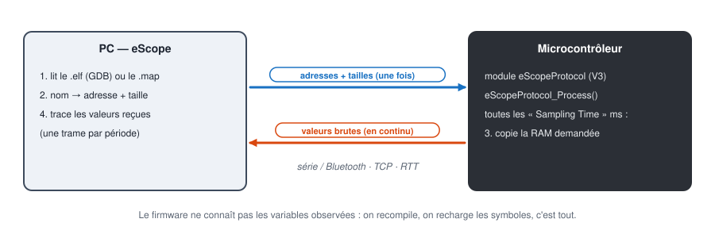

# Tutoriels eScope

[English](../tutorials/README.md) | **Français**

Pas à pas pour déployer le module eScope dans un firmware, câbler la carte, puis observer et modifier
des variables en temps réel depuis eScope.

## Parcours

| # | Tutoriel | Carte | Liaison |
|---|---|---|---|
| 1 | [Prise en main d'eScope](01-prise-en-main.md) | toutes | toutes |
| 2 | [Arduino Nano](02-arduino-nano-serie.md) | Arduino Nano (ATmega328P) | série USB 115200 |
| 3 | [STM32 NUCLEO-C051C8](03-stm32-nucleo-serie.md) | NUCLEO-C051C8 | série USB (ST-LINK VCP) 115200 |
| 4 | [Renesas FPB-RA4E1](04-ra4e1-serie.md) | FPB-RA4E1 | série SCI9 115200 (+ RTT) |
| 5 | [STM32 en RTT](05-stm32-rtt.md) | NUCLEO-C051C8 | SEGGER RTT par la sonde ST-LINK |
| 6 | [STM32 en Bluetooth](06-stm32-bluetooth.md) | NUCLEO-C051C8 + ESP32 | série 115200 → Bluetooth |
| 7 | [STM32 en Wi-Fi / TCP](07-stm32-wifi-tcp.md) | NUCLEO-C051C8 + ESP32 | série 115200 → Wi-Fi TCP |
| 8 | [Simulation du firmware sur PC](08-simulation-pc.md) | aucune (firmware en DLL) | UART simulée → TCP |

Commencez par le tutoriel de votre carte (2, 3 ou 4) : chacun va du firmware au premier tracé. Le
tutoriel 1 détaille ensuite l'utilisation d'eScope (channels, enregistrement, mesures, écriture de
variables). Les tutoriels 5 à 7 reprennent la carte STM32 avec les autres liaisons. Le tutoriel 8
exécute le firmware sur le PC, sans carte.

## Installer eScope (une fois)

1. Installer le **.NET 8 Desktop Runtime** (x64) depuis le site de Microsoft.
2. Télécharger le zip de la dernière version sur la page *Releases* du dépôt GitHub et l'extraire,
   par exemple dans `C:\eScope`.
3. Lancer `C:\eScope\eScope.exe`. Le GDB embarqué (`tools\gdb\bin\gdb-multiarch.exe`) est détecté
   tout seul : il sert à lire les symboles du `.elf`.

eScope enregistre son espace de travail (devices, traces, channels) dans `eScope.json`, **dans le
dossier courant**. Un raccourci par projet, avec le dossier du projet comme dossier de démarrage,
donne un espace de travail par projet.

Pour la liaison RTT seulement : Python 3 dans le `PATH` et `pip install pyocd` (voir le
[tutoriel 5](05-stm32-rtt.md)).

## Choisir la liaison

| Liaison | Matériel | Débit utile | Échantillonnage conseillé |
|---|---|---|---|
| Série USB 115200 | câble USB de la carte | ~11,5 octets/ms | 5 ms (8 floats) |
| Bluetooth | ESP32 + 3 fils | idem série 115200 | 5 ms |
| Wi-Fi / TCP | ESP32 + 3 fils, réseau Wi-Fi | idem série 115200 | 5 ms |
| RTT | sonde SWD (ST-LINK, J-Link) | limité par la sonde | 1 ms |

À 115200 bauds la liaison transporte environ 11,5 octets par milliseconde. Chaque trame eScope
ajoute 5 octets (en-tête et fin) aux données. Avec une période de 5 ms, une trame peut donc porter
une cinquantaine d'octets, soit 8 variables de 32 bits. C'est la valeur choisie dans les exemples.
À 1 ms, même deux floats ne passent pas.

## Exemples de firmware utilisés

| Dossier | Contenu |
|---|---|
| [`targetExamples/arduino`](../../targetExamples/arduino) | croquis `arduino.ino` et bibliothèque `DebugScope` (protocole V3) |
| [`targetExamples/stm32/NUCLEO_C051C8`](../../targetExamples/stm32/NUCLEO_C051C8) | projet STM32CubeIDE, UART ou RTT au choix dans `eScopeCfg.h` |
| [`targetExamples/ra/FPB_RA4E1`](../../targetExamples/ra/FPB_RA4E1) | projet e² studio, RTT (par défaut) ou UART SCI9 |
| [`BluetoothSerialBridge`](../../BluetoothSerialBridge) | pont série ↔ Bluetooth pour ESP32 |
| [`WifiTcpBridge`](../../WifiTcpBridge) | pont série ↔ Wi-Fi TCP pour ESP32 |
| [`targetExamples/pcsim`](../../targetExamples/pcsim) | firmware compilé en DLL (GCC, `make`) et simulateur `PcSimHost` |

Les captures d'écran de ces tutoriels ont été faites avec eScope 1.3.0. Les courbes viennent d'un
simulateur qui reproduit les variables des exemples, aux adresses de leurs `.elf`.
